# PurohitDesk Architecture v2.0 — Consolidated Engineering Document

Reading copy generated by `tools/build_consolidated.py` on 27 Oct 2026, revised to v2.1 on 28 Oct 2026 (see below).
**This document is the source of truth.** The SQL, OpenAPI, TypeScript, test and configuration artifacts it refers to
were never supplied to this repository; they are built milestone by milestone as described in `docs/plan.md`.

Status labels: **EXECUTED** (reported as run and passed by the authors of the original pack; the artifacts were not supplied, so every such result must be rebuilt and re-proven in this repository) · **DESIGN** (specified, not executed) · **VERIFY** (needs an external fact or real platform).

## Revision 2.1 — founder decisions (28 Oct 2026)

These decisions override anything below that contradicts them. Engineering rules for agents live in `CLAUDE.md` (which wins over this document on conflict); the build order lives in `docs/plan.md`.

1. **Artifacts not delivered.** `db/` migrations, seed and tests, `api/openapi.yaml`, the domain/db packages, `tools/*.py` and `config/` were not supplied. Each milestone proposes the full columns, function bodies, response shapes and tests it needs, marked PROPOSED, and the founder approves them before any migration is written. If the original files turn up, they are ported instead.
2. **Requirements.** The items marked *(reconstructed)* in `docs/01` are confirmed by the founder.
3. **Layout and tooling.** npm (not pnpm), one Next.js app at the repo root. The spec's module boundaries are folders: `src/app` (Next.js App Router), `src/domain` (pure TS, no I/O, no framework imports), `src/db` (the only place that imports the database driver), `src/adapters` (vendor SDKs).
4. **Database files.** Migrations are hand-written SQL in `supabase/migrations/`, applied by the founder in the Supabase SQL editor (the Supabase CLI is revisited in M13). Seed data in `supabase/seed/`, read-only verification scripts in `supabase/checks/`, operator scripts and runbooks in `supabase/ops/`, SQL tests in `supabase/tests/` (run by `supabase/tests/run.sh` via psql, `npm run test:db`). There is no custom migration runner and no `schema_migrations` table.
5. **Migration structure.** RLS, policies and grants go in the same migration as their table. Roles and shared helper functions go in the earliest migration. Each milestone adds only the tables and functions it needs (the seven-file layout in `docs/04` §1 is replaced).
6. **Tests against a database** run only on a throwaway Postgres (local sandbox or CI container) with no real credentials.
7. **Hosting for now.** Vercel Hobby until real users (Pro before the pilot); previews use the staging Supabase project in Mumbai (`ap-south-1`).
8. **Auth.** Supabase asymmetric JWT signing keys, verified through JWKS. Environment variables: `NEXT_PUBLIC_SUPABASE_URL`, `NEXT_PUBLIC_SUPABASE_PUBLISHABLE_KEY`, `DATABASE_URL` (server-only); every variable is listed in `.env.example`.
9. **Roles in P0.** Only OWNER is created by the product (at onboarding). Other roles, multi-priest assignment and STAFF drafts without a priest are reachable only through operator SQL (`supabase/ops/`); P0 builds no UI for them.
10. **Voice** is out of scope for the current build plan (placeholder milestone M14 after P0). Its design below is kept.
11. **Versions.** Prefer stable over newest; TypeScript is the version Next.js 16.4 officially supports (see `docs/plan.md` M0).
12. **CI** (GitHub Actions) runs lint, typecheck, tests and build on every pull request; database suites join it as they are built.
13. **Health check.** `GET /api/v1/healthz` returns `200 {"status":"ok","commit":"<git sha>"}`.
14. **Languages.** next-intl with no locale in the URL: a cookie before sign-in; after sign-in `app_users.preferred_locale`, synced to the cookie.
15. **App name** "PurohitDesk" / "पुरोहित डेस्क"; placeholder icon and theme colour; the PWA manifest and service worker land in M13.
16. **Booking numbers** `PD-YY-NNNN`: YY is the year the booking is created; the counter never resets and grows to 5+ digits after 9999.
17. **Organization slug** is generated from the practice name, unique, not editable and not shown in P0. Default organization time zone is `Asia/Kolkata`.
18. **Onboarding offerings** are whatever ceremonies the priest picks (minimum 1).
19. **Roadmap dates** in `docs/13` are reference only; work is planned by milestone without dates.
20. **The engineering-rules appendix** has moved into `CLAUDE.md`.

## Contents

- [15 — Final Summary](#15--final-summary) — `docs/15-final-summary.md`
- [00 — Source Validation (Phase 0)](#00--source-validation-phase-0) — `docs/00-source-validation.md`
- [01 — Product Requirements and MVP Definition](#01--product-requirements-and-mvp-definition) — `docs/01-product-requirements.md`
- [02 — Technology Stack and System Design](#02--technology-stack-and-system-design) — `docs/02-system-architecture.md`
- [03 — Final Architectural Decisions (ADRs)](#03--final-architectural-decisions-adrs) — `docs/03-decisions-adr.md`
- [04 — PostgreSQL Architecture](#04--postgresql-architecture) — `docs/04-database.md`
- [05 — Booking Engine](#05--booking-engine) — `docs/05-booking-engine.md`
- [06 — AI and Voice Architecture](#06--ai-and-voice-architecture) — `docs/06-voice-ai.md`
- [07 — Messaging and Communication](#07--messaging-and-communication) — `docs/07-messaging.md`
- [08 — Security and Privacy](#08--security-and-privacy) — `docs/08-security-privacy.md`
- [09 — Billing and Future Marketplace](#09--billing-and-future-marketplace) — `docs/09-billing-marketplace.md`
- [10 — Infrastructure and Operations](#10--infrastructure-and-operations) — `docs/10-infrastructure-operations.md`
- [11 — API and Implementation Contracts](#11--api-and-implementation-contracts) — `docs/11-api-contracts.md`
- [12 — Defect Resolution (Phase 3)](#12--defect-resolution-phase-3) — `docs/12-defect-resolution.md`
- [13 — Backlog, Roadmap and First Sprint](#13--backlog-roadmap-and-first-sprint) — `docs/13-backlog-roadmap-sprint.md`
- [14 — Engineering Quality Gates (Phase 5)](#14--engineering-quality-gates-phase-5) — `docs/14-quality-gates.md`
- [Appendix — CLAUDE.md (engineering rules for coding agents)](#appendix--claudemd-engineering-rules-for-coding-agents) — `CLAUDE.md`

---
# 15 — Final Summary

## A. Final architectural decisions

| Decision | Choice |
| --- | --- |
| Shape | One Next.js (TypeScript strict) PWA + API on Vercel Pro `bom1`, one Supabase Pro Postgres + Auth in Mumbai. No separate backend, worker or queue in P0. |
| Where correctness lives | PostgreSQL: FORCE RLS with membership predicates, composite tenant keys, `role_permissions` matrix, 27 `SECURITY DEFINER` command functions (all writes), state-machine guard, deferred invariant triggers, exclusion constraint on the global priest identity, append-only history and ledger, in-transaction idempotency. |
| API role | `app_runtime`: SELECT under RLS + EXECUTE on commands; **no** INSERT/UPDATE/DELETE. Privileged work through five NOLOGIN roles; nothing has BYPASSRLS. |
| Data access | `postgres.js` (`prepare:false`, Supavisor transaction mode) through `withTenantTx`; no ORM, no query builder; hand-written forward-only SQL migrations. |
| Tenancy | Organization tenant; global `priest_profiles`; consented `organization_priests` links (BOOTSTRAP in P0, priest-accepted INVITATION in P1). |
| Bookings | DRAFT → CONFIRMED → COMPLETED / CANCELLED; reschedule is an event; date-only drafts, tentative windows, overnight ≤ 7 days; ceremony overlap is impossible; travel-buffer overlap needs an explicit, recorded acknowledgement; multi-priest all-or-nothing. |
| Money | Offline dakshina ledger in integer paise, append-only, reversals, derived balance. SaaS billing P1; marketplace settlement P2 via a licensed PSP only. |
| Voice | ≤ 30 s WAV → Sarvam STT → Gemini 2.5 Flash (paid tier) structured phrases → deterministic TS resolvers → review draft → priest confirms → normal `create_booking`. No audio stored; transcripts 7 days. Behind a flag, gated by an evaluation spike. |
| Messaging | P0 manual `wa.me`/Web Share with server-rendered Hindi/English text; P1 Cloud API with outbox, consent, HMAC-verified webhooks. |
| Contract | `api/openapi.yaml` (40 operations), checked in CI against the live schema and real outputs. |

## B. What NOT to build yet

- No worker, queue, outbox, Redis, pg-boss, Procrastinate, Railway/Render (P1 at the earliest, by ADR).
- No public inquiry page, magic links, customer accounts, family/household model, consent tables (P1).
- No invitations or cross-organization priest linking UI (P1; the database already blocks unconsented links).
- No WhatsApp Business API, reminders, SMS, phone OTP before DLT clarity.
- No subscriptions/billing, entitlements engine, paid plans (P1, after pilot evidence).
- No marketplace tables, discovery, leads, reviews, payments, DISPUTED state (P2).
- No Panchang/muhurat engine, recurring series, working-hours rules, Punjabi UI (P1+).
- No audio storage, no model training, no automatic booking from voice.
- No FastAPI/Python service, no self-issued JWTs, no Supabase Data API on `app`, no service-role key in the app.
- No PITR add-on until there are paying users.

## C. Remaining risks and unverified assumptions

The thirteen items U1–U13 in `docs/14` §3 are the complete list. The three that can change the architecture:

1. **U1–U3 (Supabase platform behaviour)**: role creation/ownership hand-over as `postgres`, custom login role through Supavisor, transaction-local context under pooling. Everything was proven on PostgreSQL 16 locally, not on Supabase. Fallbacks are named in `docs/13` (no BYPASSRLS workaround allowed).
2. **U6 (voice accuracy on real speech)**: decides whether voice ships in P0 at all. The rest of P0 does not depend on it.
3. **U11 (DPDP roles and obligations)**: the design assumes priest = data fiduciary, PurohitDesk = processor; counsel must confirm before the ~May 2027 obligations.

Product risk outside engineering: pandits may not adopt a diary app at all. The pilot (S5) with 3–5 priests is the real test; the architecture is deliberately small so that a negative answer costs weeks, not months.

## D. Exact first engineering sprint (weeks 1–2)

> Revision 2.1: reference only. The build order is `docs/plan.md` (M0–M3 cover this sprint). There is no custom migration runner (T-02 dropped).

Goal: a signed-in user creates a practice on **staging** through the real API, isolation is proven on the real platform, and every gate runs green in CI.

1. **T-01** Project + CI (day 1): one Next.js app at the repo root (npm), `.github/workflows/ci.yml` running lint, typecheck, unit tests and build; SQL suites join as they are built.
2. **T-02** *(dropped in revision 2.1: migrations are applied in the Supabase SQL editor; Supabase CLI revisited in M13)*.
3. **T-03** Staging Supabase in Mumbai: Data API off for `app`, migrations + seed, `app_runtime` login, hourly retention Cron (day 3).
4. **T-04** Platform proof (days 4–5): `platform_smoke.sql` through Supavisor as `app_runtime`; 1,000-request two-tenant test from Vercel `bom1`; latency; findings into `docs/14`.
5. **T-05** Auth + tenant context (days 6–7): JWKS verification, real `withTenantTx`, membership probe, error envelope, lint boundary; 401/404/revocation tests.
6. **T-06** `/session`, `/me` (day 8).
7. **T-07** Onboarding + minimal PWA shell in Hindi/English (day 9).
8. Review, update docs, demo (day 10).

## E. Architecture readiness assessment

**Ready to start implementation: yes, with one blocking spike.**

> Revision 2.1: the "Ready" rows below describe the original pack, whose artifacts were not supplied. In this repository the schema, API contract and domain code are **designed, not built**; each is rebuilt and re-proven in the milestone that needs it (`docs/plan.md`).

| Area | Readiness | Basis |
| --- | --- | --- |
| Database schema, security, booking engine, ledger, voice lifecycle | **Designed; to be rebuilt per milestone** (the original pack reported 156 SQL assertions, 8 concurrency checks, 6 smoke checks, 37 gates) | This document |
| API contract | **Designed; written per milestone** | Endpoint table in `docs/11` |
| Domain TS (resolvers, money, share, errors) | **Designed; written per milestone with tests** | This document |
| Application code (routes, UI) | **Not built** | Sprint 1–4 tickets with acceptance criteria |
| Platform (Supabase/Supavisor/Vercel) | **Blocking verification** | T-04 in week 1; the rest of Sprint 2 depends on it |
| Voice in production | **Not ready — gated** | T-15 evaluation decides |
| Compliance | **Design ready; legal confirmation pending** | U11 before May 2027 |

Must be resolved first: (1) run T-04 on a real Supabase project (`docs/plan.md` M2–M3); (2) ~~provide the original requirements prompt~~ — resolved 28 Oct 2026: the founder confirmed the *(reconstructed)* items in `docs/01`.

---

# 00 — Source Validation (Phase 0)

Status legend used in every document of this pack:

| Label | Meaning |
| --- | --- |
| **EXECUTED** | Reported as reproduced by running code in the original pack (SQL suite, concurrency harness, consistency gates, unit tests). Test IDs are given. Revision 2.1: that code was not supplied to this repository; each result must be rebuilt and re-proven here. |
| **DESIGN** | Specified and reviewed, not executed (application code, hosting, vendors). |
| **VERIFY** | Depends on an external fact or platform behaviour that must be confirmed before or during Sprint 1. |

## 1. Inputs received

| # | Source | Available | File and SHA-256 (first 16 hex) | How it was used |
| --- | --- | --- | --- | --- |
| 1 | Original PurohitDesk requirements prompt | **NO** | — | Requirements were reconstructed from where A (pp. 1–2, 7–12) and B (§01) restate the brief. See §3. |
| 2 | Architecture A (PDF, 76 pages) | Yes | `Arch_A_…pdf` `35843dd73411d037` | Text extracted page by page; DDL on pp. 32–38 executed in the previous review. |
| 3 | Architecture B (Markdown) | Yes | `Arch_B_PurohitDesk_Architecture_Complete.md` `55aff5a065c2ff5c` | Sections 01–16 and "Final Handoff" re-read. |
| 4 | Architecture B migration | Yes | `Arch_B_0001_initial.sql` `a4bfb5ccf4e35c79` | Executed in the previous review; superseded by this document (migrations are rebuilt in `supabase/migrations/`). |
| 5 | Architecture B OpenAPI | Yes | `Arch_B_openapi.yaml` `13f9d260afe2a5b0` | Parsed; superseded by this document (`api/openapi.yaml` was not supplied). |

Artifacts that B references but that were not supplied: the ZIP pack, `docs/*.md`, `db/seed_catalog.sql`, `tests/acceptance-matrix.md` (B, "Read this first"). They are not required: this pack replaces them (`supabase/seed/ceremony_types.sql`, `docs/14-quality-gates.md`).

## 2. Request to the founder

> Resolved 28 Oct 2026: the founder confirmed items 1–5 below as stated in `docs/01`; the original prompt is not needed.

**Please provide the original requirements prompt.** It is the only critical source that is missing. Until it is checked, the following requirement statements in `docs/01-product-requirements.md` are marked *reconstructed* and should be confirmed or corrected:

1. Initial geography and languages (Chandigarh Tricity; Hindi and English UI; Punjabi later).
2. That P0 is a B2B tool for priests only (no customer-facing booking in P0).
3. The voice example utterance ("Agle Sunday Sharma ji ki Griha Pravesh puja… Dakshina 5100 aur advance 1100") and its expected interpretation.
4. Whether collectives (several priests under one organization) are a P0 or P1 need.
5. Any pricing, revenue or timeline constraints stated in the original brief.

Also useful, not blocking: whether the founder is more fluent in Python or TypeScript (it affects the learning curve, not the decision; see ADR-001).

## 3. Re-examination: where the new evidence changed earlier conclusions

The previous review was re-checked against the sources and against what was executed while building this pack. Four earlier conclusions changed:

| Earlier conclusion | New evidence | Revised position |
| --- | --- | --- |
| "Keep domain logic out of PL/pgSQL; it is harder to test" (review §3, rejected alternative). | The full command layer was written in PL/pgSQL and exercised by 156 assertions, a two-session concurrency harness and 37 consistency gates, all as the real application roles. The tests found 13 defects in the first drafts, all fixed and re-tested (`docs/12` §3). | Business **invariants and writes** live in SQL command functions; TypeScript owns HTTP, auth, validation, rendering and vendors. ADR-003. The Supabase Data API stays **off** (that part of the earlier rejection stands). |
| "Override shrinks the booking's stored buffers" (review §4, import 2). | Shrinking buffers loses the information the priest needs to see later and is invisible in history. | Buffers are kept as entered; a buffer-only overlap returns `BUFFER_CONFLICT`, and the priest re-sends with `ack_buffer_overlap=true`, which is recorded on the booking and in its history. Ceremony overlap is never overridable. ADR-006. |
| "Voice: process a ≤60 s note in the request" (review §6). | Sarvam's synchronous REST API accepts up to 30 seconds per request. | P0 voice notes are capped at 30 s (client-enforced, server-checked). ADR-009. |
| "Typed query builder (Kysely) over the live schema" (review §3). | With writes inside SQL functions, the TypeScript side only calls functions and runs a handful of read queries. | `postgres.js` tagged templates; no ORM or query builder. ADR-002. |

Conclusions that the re-examination confirmed: B as the base, TypeScript full-stack, global priest identity, composite tenant keys, reservations as the single source of busy time, no stored RESCHEDULED state, deterministic date resolution, manual WhatsApp in P0, no worker in P0, marketplace deferred to P2.

## 4. Vendor and regulatory facts re-verified on 27 Oct 2026

| Fact used in this pack | Source |
| --- | --- |
| Sarvam STT: ₹0.49/min pay-as-you-go, billed per second, excludes GST; ₹100 free credits | [Sarvam pricing](https://docs.sarvam.ai/api/getting-started/pricing) |
| Sarvam sync REST: up to 30 s per request; WAV 16 kHz mono recommended; `saaras:v4` default; Batch API up to 2 h | [Sarvam STT REST guide](https://docs.sarvam.ai/api/api-guides-tutorials/speech-to-text/rest-api.md) |
| Gemini 2.5 Flash paid tier $0.30 / $2.50 per 1M input/output tokens; Flash-Lite $0.10 / $0.40; free-tier content is used to improve products, paid tier is not | [Gemini API pricing](https://ai.google.dev/gemini-api/docs/pricing) |
| Gemini 2.5 Flash has no announced shutdown date; OpenAI `gpt-4o-mini-2024-07-18` shuts down 14 Jan 2027 | [Gemini deprecations](https://ai.google.dev/gemini-api/docs/deprecations), [OpenAI deprecations](https://developers.openai.com/api/docs/deprecations/index.html) |
| Vercel functions: default region `iad1` (must be changed to `bom1`); Pro 300 s default, 800 s max; 4.5 MB request body limit | [Vercel functions limits](https://vercel.com/docs/functions/limitations), [Vercel regions](https://vercel.com/docs/regions) |
| Vercel Hobby is for personal, non-commercial use | [Vercel Hobby plan](https://vercel.com/docs/plans/hobby) |
| Vercel Pro: $20 per seat/month including $20 usage credit (secondary source, May 2026; confirm on Vercel's pricing page at signup) | [MakerKit, Vercel cost 2026](https://makerkit.dev/blog/saas/vercel-cost) |
| Supabase Pro $25/month incl. $10 compute credit; Mumbai `ap-south-1` region available; PITR add-on ~$100/month for 7 days | [Supabase pricing](https://supabase.com/pricing.md), [regions](https://supabase.com/docs/guides/platform/regions.md), [PITR](https://supabase.com/docs/guides/platform/manage-your-usage/point-in-time-recovery) |
| Supabase: only `service_role` and `supabase_etl_admin` have BYPASSRLS; Supabase Cron can schedule SQL functions | [Supabase roles](https://supabase.com/docs/guides/database/postgres/roles.md), [Supabase Cron](https://supabase.com/docs/guides/cron.md) |
| Render and Railway have no India region | [Render regions](https://render.com/docs/regions), [Railway feature request](https://station.railway.com/feedback/feature-request-add-an-india-infrastruc-fee82197) |
| WhatsApp: Meta resumed charging in-window utility templates on 1 Oct 2026; India utility ~₹0.145, marketing ~₹1.09 (BSP rate card, secondary) | [Meta pricing](https://developers.facebook.com/documentation/business-messaging/whatsapp/pricing.md), [AiSensy](https://m.aisensy.com/blog/whatsapp-pricing-update-october-2026/) |
| DPDP Rules: phased; Rule 4 ~13 Nov 2026, main obligations ~13 May 2027; Oct 2026 Removal of Difficulties Order | [Mondaq](https://www.mondaq.com/dpdp-act-and-rules-2025-the-2026-compliance-milestones-businesses-cant-afford-to-miss/1830402), [India Briefing](https://www.india-briefing.com/news/dpdp-removal-of-difficulties-order-2026-consent-data-audit-47274.html/) |

Legal items are research notes, not legal advice; `docs/08` lists what counsel must confirm.

---

# 01 — Product Requirements and MVP Definition

> Requirements marked *(reconstructed)* come from A (pp. 1–2, 7–12) and B (§01) because the original prompt was not supplied (`docs/00`). Revision 2.1: the founder confirmed them on 28 Oct 2026.

## 1. Product statement

PurohitDesk is a mobile-first SaaS diary and back office for Hindu priests (pandits). It replaces the paper diary, WhatsApp-scrolling and memory with: conflict-safe bookings, customer records, samagri lists, dakshina records and one-tap WhatsApp sharing, in Hindi and English. It is software the priest operates himself. PurohitDesk never arranges ceremonies, assigns priests or handles money in P0 or P1. *(reconstructed)*

Users at launch: 3–10 pandits in Chandigarh, Mohali and Panchkula, on inexpensive Android phones (2–3 GB RAM, Chrome, intermittent 4G), Hindi or English UI, already living in WhatsApp.

## 2. Personas

| Persona | P0 role | Needs |
| --- | --- | --- |
| Solo pandit (owner) | OWNER of his own practice | Never double-book; remember who, where, what samagri, how much dakshina is due; send details to the family in Hindi. |
| Family member / assistant | STAFF (P1 invitations; P0 only via operator) | Draft bookings and record payments, but not confirm. |
| Collective head (mandir, group of priests) | OWNER/ADMIN of a COLLECTIVE (P1) | Assign lead and assistant priests; see everyone's calendar. |
| Family (customer) | Not a user in P0 | Receives a WhatsApp message. Gets a magic-link receipt in P1. |

## 3. Scope

### P0 — Essential B2B SaaS (weeks 1–10, pilot)

| Area | In P0 |
| --- | --- |
| Access | Sign-in with Google (Supabase Auth). Phone OTP only after DLT/cost check (VERIFY). One practice per signup, up to 3 per user. |
| Practice | Solo practice onboarding, priest profile, offerings seeded from a 20-ceremony catalog (Hindi + English names; the priest picks at least one), default travel buffers. Default time zone `Asia/Kolkata`. |
| Customers | Create, edit, search by name prefix or phone; phone optional; shared household phone allowed with a duplicate warning; erase on request; CSV export. |
| Bookings | Draft (date only, or no time yet), confirm, edit, reschedule, cancel (reason), complete; tentative time windows; overnight ceremonies (≤ 7 days); calendar blocks; travel-buffer warnings with explicit acknowledgement; booking number `PD-YY-NNNN` (YY = year of creation; the counter never resets and grows past 4 digits after 9999); history. Revision 2.1: multi-priest assignment, STAFF drafts without a priest and roles other than OWNER have no UI in P0; operator SQL only (`supabase/ops/`). |
| Agenda | Day and week list; free/busy across all organizations the priest serves (other organizations shown as "busy", no details). |
| Samagri | Template per offering; snapshot onto the booking; items marked FAMILY or PRIEST provides. |
| Dakshina | Agreed amount; record receipts and refunds (cash, UPI, bank, other); reverse mistakes; derived balance. No money moves through PurohitDesk. |
| Sharing | Render booking details + family's samagri list in Hindi or English; open `wa.me` (or the Android share sheet). Logged as "share prepared", never as "delivered". |
| Voice (behind a flag, last P0 feature; revision 2.1: out of scope for the current build plan, placeholder M14) | ≤ 30 s Hindi/Hinglish note → editable draft with flagged ambiguities → priest confirms → booking. |
| Data rights | CSV export of own data; customer erasure; account deletion by operator runbook. |

### P1 — Advanced SaaS and monetization (after 3–5 priests use P0 weekly for 4 weeks)

Collectives: invitations, member management, consented cross-organization priest linking (the priest accepts), phone masking for junior roles. Official WhatsApp Business API with consent records, outbox, worker, webhooks, reminders. Public inquiry page (anti-spam) and family magic-link receipt/samagri checklist. SaaS subscriptions and entitlements. Punjabi UI. Recurring series. Families/households. Working-hours rules. UPI deep link for collecting dakshina (still no custody of money).

### P2 — PurohitBook marketplace (optional, opt-in)

Discovery, leads, quotes, verified reviews, marketplace-sourced customers (`acquisition_source = MARKETPLACE`), PSP split settlement, disputes. Gate: P1 retention plus legal and PSP clearance (`docs/09`).

### Explicit exclusions (not in P0 or P1 unless re-decided by ADR)

- PurohitDesk does not take bookings on behalf of priests, assign priests to families, or employ priests.
- No custody of customer money; no payment gateway in P0 (P1 SaaS billing only, P2 marketplace payments optional).
- No Panchang/muhurat computation; dates like "Kartik Purnima" are never converted automatically.
- No native Android app (PWA only); no offline write queue in P0.
- No customer accounts in P0.
- No automatic WhatsApp sending in P0.
- No ML training on customer data; no storage of voice audio.

## 4. Functional acceptance criteria (P0)

Each criterion names the executed test that proves the database half of it. The UI half is verified in the ticket's Definition of Done (`docs/13`).

| ID | Criterion | Database proof (EXECUTED) |
| --- | --- | --- |
| AC-01 | A new user can create a practice in one step; a retried request returns the same practice; a fourth practice is refused. | `01_bootstrap_identity.sql` |
| AC-02 | A member of org A never sees or changes org B's data, even with B's id in `X-Tenant-ID`; a revoked member loses access on the next request. | `02_isolation_authz.sql` (22) |
| AC-03 | A priest cannot be confirmed into two overlapping ceremonies, even when the bookings belong to two organizations and arrive at the same moment. | `04_conflicts_…sql`, `concurrency.sh` |
| AC-04 | A booking whose travel buffer overlaps another is refused with `BUFFER_CONFLICT` until the priest acknowledges; the acknowledgement is stored and shown in history. | `04` |
| AC-05 | A multi-priest booking reserves all priests or none. | `04` |
| AC-06 | A draft can hold only a date ("1 Nov, time not fixed"); confirming requires a start and end time and a lead priest. | `03 › date-only draft allowed`, `› cannot confirm without a time`; `04 › confirming requires a LEAD priest` |
| AC-07 | Reschedule into a conflict leaves the original slot untouched; a successful reschedule releases the old slot and holds the new one atomically. | `04` |
| AC-08 | Cancel releases the slot; complete is allowed only after the start time and keeps the slot as history; completed or cancelled bookings cannot be re-opened. | `03`, `05` |
| AC-09 | Two people editing the same booking: the second save fails with `VERSION_CONFLICT`. | `03` |
| AC-10 | Payments are never edited or deleted; a mistake is reversed with an exact negating entry; balance = agreed − Σ entries. | `06_ledger.sql` |
| AC-11 | A voice note never creates a booking by itself; only the member who recorded it can apply it, once; transcripts are purged after 7 days. | `07_voice.sql`, `08` |
| AC-12 | Erasing a customer removes name, phone, address, free text in their bookings (title, place, notes, cancel reason), ledger notes and UPI references, linked transcripts and stored API responses; ledger amounts and busy times survive. | `08_erasure_retention.sql` |
| AC-13 | Retrying any write with the same `Idempotency-Key` returns the first result; reusing a key for a different request is refused. | `09_idempotency.sql`, `concurrency.sh` |
| AC-14 | Sharing renders Hindi with correct ₹ grouping and only the samagri the family must arrange, and builds a `wa.me` link. | `domain.test.ts` |
| AC-15 | "Agle Sunday" said on a Monday is shown as a choice between both Sundays; "Kartik Purnima" is never converted. | `domain.test.ts` |

## 5. Non-functional targets (design objectives, not measured)

| Target | Value | Status |
| --- | --- | --- |
| First load on a 2–3 GB Android over 4G | ≤ 3 s to interactive for the agenda; JS ≤ 200 KB gzipped on the agenda route | VERIFY in Sprint 2 (Lighthouse, real device) |
| API p95 from Chandigarh (Vercel `bom1` + Supabase Mumbai) | ≤ 400 ms for reads, ≤ 700 ms for commands | VERIFY (spike T-04) |
| Voice draft | ≤ 10 s from upload to draft for a 20 s note | VERIFY (spike T-15) |
| Availability | Best effort, single region; RPO ≤ 24 h (daily backups) in P0 | DESIGN |
| Languages | Hindi (Devanagari) and English UI; Hinglish input everywhere | DESIGN |
| Accessibility | 16 px minimum text, 44 px tap targets, works at 360 px width | DESIGN |

---

# 02 — Technology Stack and System Design

## 1. Selected architecture: "SQL core, TypeScript shell"

One deployable web application plus one managed database. No separate backend service, no worker, no queue in P0.

| Layer | Choice | Why |
| --- | --- | --- |
| UI | Next.js (App Router) PWA, React, TypeScript strict, Tailwind; Hindi/English via next-intl message catalogs, no locale in the URL (cookie before sign-in; `app_users.preferred_locale` after, synced to the cookie). App name "PurohitDesk" / "पुरोहित डेस्क" | One language for UI and API; installable on Android without a Play Store app. |
| API | Next.js route handlers under `/api/v1`, Zod request validation, `postgres.js` | Thin: authenticate, validate shape, call one SQL function, map errors. |
| Domain (TS) | `src/domain`: framework-free pure functions (date/time resolution, money, WhatsApp text, error mapping, permission helpers) | Unit-testable without a database or framework. |
| Domain (SQL) | `app` schema: tables, constraints, RLS, **command functions** (all writes), read model `get_booking` | Invariants that must never break are enforced where every write passes. |
| Database | Supabase Postgres 15+/16, Pro plan, Mumbai `ap-south-1` | Managed Postgres with Auth, backups, Cron, India region. |
| Auth | Supabase Auth (Google first; phone OTP after DLT check) — JWT verified server-side | Avoid building auth (A's self-issued JWTs rejected). |
| Hosting | Vercel Pro, functions pinned to `bom1` (Mumbai) | Default region is `iad1`; must be set. Hobby is non-commercial. |
| Scheduling | Supabase Cron runs `app.run_retention()` hourly | No worker needed in P0. |
| Speech-to-text | Sarvam `speech-to-text` REST (sync, ≤ 30 s) behind an adapter | Indian-language accuracy, INR pricing, India-based vendor. |
| Extraction LLM | Gemini 2.5 Flash (paid tier) structured output behind an adapter; Flash-Lite as cheaper fallback | Cheap, JSON-schema output, no announced shutdown. Paid tier: content not used for training. |
| Errors/monitoring | Sentry (free/dev tier), Vercel logs, Supabase logs, uptime ping | Enough for a pilot. |

## 2. System context (C4 level 1)

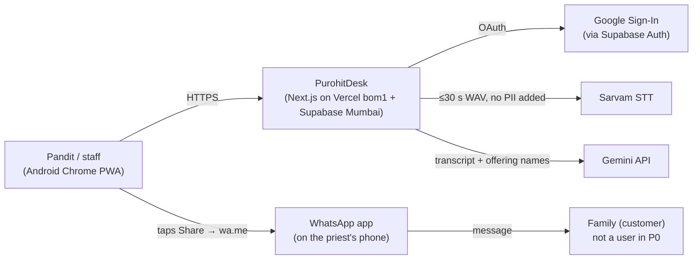

PurohitDesk never talks to WhatsApp in P0: the priest's own WhatsApp sends the message.

## 3. Containers (C4 level 2)

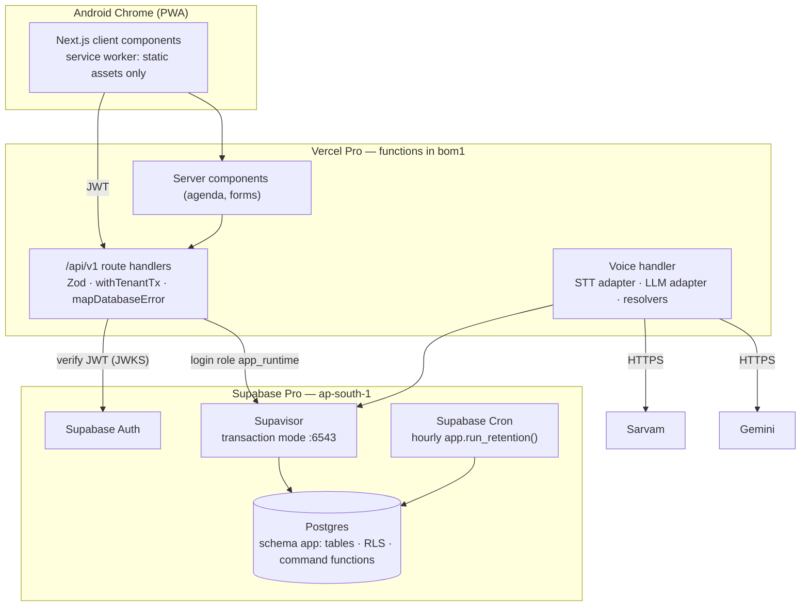

The browser never talks to Postgres: the Supabase Data API (PostgREST) is disabled for the `app` schema and `anon`/`authenticated` have no privileges on it.

## 4. Modules and ownership

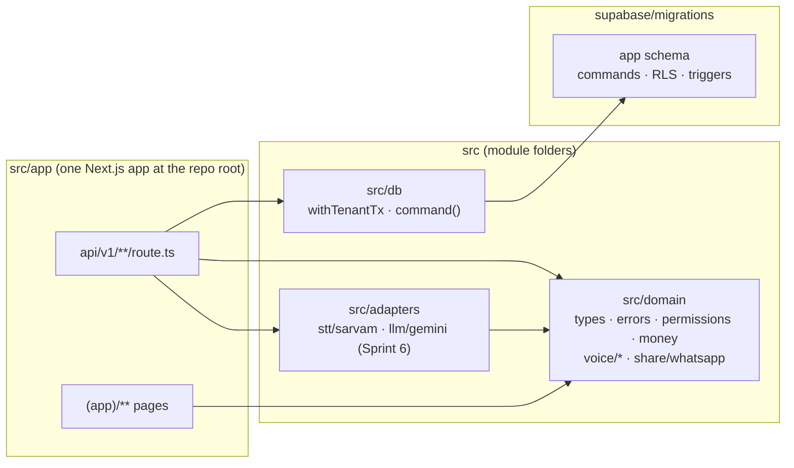

Rules (enforced by `CLAUDE.md` and code review):

1. Only `src/db` imports the database driver. Only `withTenantTx` opens transactions.
2. A route handler calls **one** command function per write request. It never issues INSERT/UPDATE/DELETE (the login role cannot: gate `db: app_runtime has no INSERT/UPDATE/DELETE`).
3. `src/domain` has no I/O and no framework imports.
4. Vendor SDKs appear only in `src/adapters`; model names only in configuration.

## 5. Request lifecycle (write)

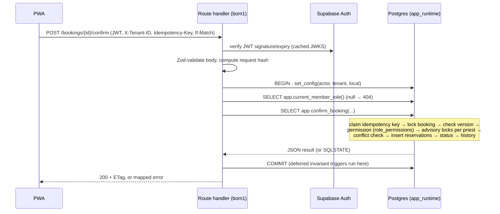

## 6. Deployment and environments

| Environment | Web | Database | Data | Purpose |
| --- | --- | --- | --- | --- |
| local | `next dev` | Throwaway Postgres for SQL tests (sandbox or Docker); never a real or shared database | Fixtures only | Development, SQL tests |
| CI | — | Postgres 16 service container | Throwaway | typecheck, unit tests, SQL suite, concurrency, smoke, gates (`.github/workflows/ci.yml`, EXECUTED locally; the workflow itself first runs in T-01) |
| staging | Vercel preview (Pro) | Separate Supabase project (Micro), Mumbai | Synthetic only, never real customers | Migration rehearsal, spike measurements |
| production | Vercel production, `bom1` | Supabase Pro, Mumbai | Real | Pilot |

Promotion (DESIGN — the deploy jobs are built in T-02/T-21; today's `ci.yml` only runs the checks): PR → CI green → merge to `main` → migration applied to staging → manual approval → production migration → Vercel production deploy. Migrations are forward-only; see `docs/10`.

## 7. Operational responsibilities (one founder)

| Responsibility | Mechanism | Frequency |
| --- | --- | --- |
| Retention (transcripts 7 d, idempotency 24 h, audit 12 months, stuck voice jobs) | Supabase Cron → `app.run_retention()` | Hourly, automatic |
| Backups | Supabase daily backups + weekly encrypted `pg_dump` to founder-controlled storage | Weekly check; restore drill monthly |
| Security patches | Dependabot/Renovate PRs; Supabase patch notices | Weekly |
| Vendor spend | Sarvam/Gemini dashboards + `voice_extractions.est_cost_paise` daily sum | Weekly |
| Data requests (export, erasure, account deletion) | In-app export/erase; account deletion runbook `supabase/ops/runbook.md` | On request, ≤ 7 days |
| Incidents | Sentry alert → founder phone; status message to pilot priests on WhatsApp | As needed |

---

# 03 — Final Architectural Decisions (ADRs)

Each record states what A proposed, what B proposed, what the previous review concluded, the final decision, the justification and trade-offs, and the implementation implications. Citations: A by PDF page, B by section (§) of the Markdown, previous review by its section. Status of the evidence is EXECUTED or DESIGN (`docs/00`).

---

## ADR-001 — One language: TypeScript full-stack modular monolith

| | |
| --- | --- |
| **A** | Python 3.12 + FastAPI + SQLAlchemy 2 (async) + Pydantic + Alembic backend, Next.js 15 frontend, Python worker; OpenAPI→TS codegen to keep them in sync (pp. 2–3, 69). |
| **B** | Next.js full-stack route handlers + shared TS domain packages + standalone `pg-boss` worker (§02, ADR-001). |
| **Previous review** | TypeScript full-stack; Python only later beside the monolith for ML/analytics (review §3). |
| **Final decision** | TypeScript full-stack. **One** deployable in P0 (Next.js on Vercel `bom1`) plus Supabase. No worker until P1 has a real asynchronous consumer (ADR-008). |
| **Justification** | The frontend must be TypeScript in both designs, so Python is a second language, not a replacement. Render and Railway have no India region, so A's FastAPI host would also need AWS/another container host to stay near Mumbai. Every component that must be correct (exclusion constraints, tenant keys, RLS, invariants, commands) is SQL — the founder's strongest skill — and is language-neutral. |
| **Trade-offs** | Founder may know Python better (unknown; `docs/00` §2). Next.js has a learning curve; mitigated by keeping domain logic out of React and the API layer thin. Offline evaluation notebooks may still be Python; they are not production. |
| **Implications** | Revision 2.1: npm, one Next.js app at the repo root with module folders `src/app`, `src/domain`, `src/db`, `src/adapters` (was: pnpm workspace with `apps/web` and `packages/*`). Node ≥ 22.18. One CI pipeline. |

## ADR-002 — Data access: `postgres.js` tagged SQL, no ORM, no query builder

| | |
| --- | --- |
| **A** | SQLAlchemy 2 async + Alembic autogenerate (pp. 2, 58). |
| **B** | "Drizzle or parameterized `pg` queries" (§ Read this first, §02). |
| **Previous review** | Hand-written SQL migrations + Kysely with generated types (review §3). |
| **Final decision** | `postgres.js` with `prepare: false` (required behind Supavisor's transaction pooler), through one helper `withTenantTx`. Migrations are hand-written SQL files. Writes are calls to SQL command functions; reads are plain SQL. |
| **Justification** | Once writes are SQL functions (ADR-003), the TS side issues ~40 short statements; a query builder adds a dependency and a second schema model without adding safety. ORM migration generators cannot express exclusion constraints, deferred constraint triggers or RLS anyway. |
| **Trade-offs** | No compile-time column checking for read queries. Mitigation: response types are validated against OpenAPI in CI with real database output (gate `samples:`), and read queries live next to their route with a test. |
| **Implications** | `src/db/tenant-tx.ts` (written in M2; the original pack's version was not supplied). A lint rule forbids importing `postgres` outside `src/db`. |

## ADR-003 — Business writes as PostgreSQL command functions (reverses part of the previous review)

| | |
| --- | --- |
| **A** | Domain services in Python; database for constraints and (partial) RLS (pp. 15–16, 38). |
| **B** | Domain services in TS; RLS for tenancy; booking invariants "enforced in transaction" by service code (§04). |
| **Previous review** | Rejected "Supabase Data API with PL/pgSQL functions as the backend" because it exposes the schema and PL/pgSQL is "harder to test" (review §3). |
| **Final decision** | Every write goes through a `SECURITY DEFINER` PL/pgSQL **command function** (`app.create_booking`, `app.confirm_booking`, … 27 functions). The API login role `app_runtime` has **SELECT only** on tables and EXECUTE on those functions. The Data API stays off. |
| **Justification** | EXECUTED evidence replaced the earlier assumption: the command layer was tested by 156 assertions and a concurrency harness, running as the real roles; the tests found 13 defects in the first drafts, all fixed and re-tested (`docs/12` §3). With writes in SQL, a bug in a route handler cannot write a cross-tenant row, skip a permission check, forget the version check, or leave a booking without its reservation — the login role physically cannot issue DML (gate `db: app_runtime has no INSERT/UPDATE/DELETE`). This plays directly to the founder's SQL strength. The earlier objection (schema exposure) is avoided by keeping PostgREST off; the testing objection is answered by `supabase/tests/`. |
| **Trade-offs** | PL/pgSQL is less ergonomic than TS for string handling and has weaker tooling (no type checker across functions; stack traces in SQL). Refactors need migrations. Mitigations: keep functions short and single-purpose; rendering, vendors and date parsing stay in TS; every function has tests; `check_consistency.py` ties SQL enums, permissions and signatures to TS and OpenAPI. |
| **Implications** | New write = new/changed SQL function + SQL test + OpenAPI `x-db-function` + route handler. Function owners are NOLOGIN roles (ADR-005). |

## ADR-004 — Tenancy: organization tenant, global priest identity, consented links

| | |
| --- | --- |
| **A** | `tenants` + `provider_profiles` per tenant (pp. 21–23, 36). Same human in two tenants = two rows, so cross-tenant double-booking is undetectable (review A3). |
| **B** | Organization tenant + global `priest_profiles` + `organization_priests` link (§03, ADR-004); any org admin could link any priest (review B2). |
| **Previous review** | B's model; linking only by invitation the priest accepts (P1). |
| **Final decision** | B's model with: `app_users.id` = Supabase auth uid but decoupled (`auth_user_id … ON DELETE SET NULL`); `priest_profiles.user_id` unique (one profile per human); `organization_priests.linked_via ∈ {BOOTSTRAP, INVITATION}`. In P0 the only link is BOOTSTRAP (own practice), created by `app.bootstrap_practice`. The API role has no INSERT on `organization_priests` at all. P1 adds `accept_priest_invitation` executed by the priest himself. |
| **Justification** | Busy time must be keyed on the human, not the tenant (EXECUTED: `04` cross-org conflict). Consent must be enforced by privileges, not by UI (EXECUTED: `02` "org B cannot link a priest without his consent"). |
| **Trade-offs** | Join through `organization_priests` everywhere a priest is referenced. A human who creates two accounts can still create two profiles (VERIFY in P1: phone-verified identity). |
| **Implications** | Composite FK `(org_id, organization_priest_id, priest_profile_id)` on reservations guarantees a reservation's profile matches the link. |

## ADR-005 — Authorization: membership RLS + permission matrix in the database + one role per privileged purpose

| | |
| --- | --- |
| **A** | Tenant id in a 15-minute self-issued JWT; RLS on 3 of 11 tables checking only the tenant setting (pp. 38, 48). |
| **B** | Membership-checked RLS on all tables, role checks in TS service layer; bootstrap needed BYPASSRLS; worker had no defined role (§07; review B1, B8). |
| **Previous review** | B plus NOLOGIN roles per purpose instead of BYPASSRLS. |
| **Final decision** | (1) Supabase JWT verified server-side; tenant chosen per request (`X-Tenant-ID`), never trusted from a token. (2) RLS ENABLE + FORCE on every tenant/identity table; predicate checks ACTIVE membership on every statement. (3) Role→permission matrix stored once in `app.role_permissions`; every command calls `assert_permission` or the `_OWN` variant (PRIEST acting on bookings he leads). (4) Roles: `app_runtime` (API login: SELECT + EXECUTE), `app_domain` (owns commands), `app_authz` (owns membership helpers), `app_bootstrap` (first practice), `app_freebusy` (cross-org busy spans, times only), `app_maintenance` (retention). All NOLOGIN except runtime; none has BYPASSRLS; every policy is role-scoped (`TO …`), none to PUBLIC. |
| **Justification** | Revocation effective on the next statement (EXECUTED `02`); no path needs BYPASSRLS (gate `db: no application role has BYPASSRLS`); permission names identical across SQL/TS/OpenAPI (gate `rbac:`). |
| **Trade-offs** | More roles to understand. Supabase must allow creating roles and handing over function ownership as the `postgres` user — VERIFY on a real project (Sprint 1, T-04). |
| **Implications** | `supabase/ops/runbook.md` operator steps; `docs/08` RBAC matrix. |

## ADR-006 — Scheduling: reservations table, exclusion constraint on ceremony time, checked travel buffers

| | |
| --- | --- |
| **A** | Exclusion on bookings using `tstzrange(start − buffer, end + buffer)` (fails: STABLE expression, review A1); override flag removes a booking from the constraint (A4); stored RESCHEDULED status (A5). |
| **B** | `calendar_reservations` with GiST exclusion on global `priest_profile_id`; buffers described but not stored (B4); booking↔reservation consistency left to services (B3). |
| **Previous review** | B's table; store buffers; override shrinks buffers; deferred invariant triggers. |
| **Final decision** | `calendar_reservations(span, buffer_span, status ACTIVE/RELEASED)`; `EXCLUDE USING gist (priest_profile_id WITH =, span WITH &&) WHERE status='ACTIVE'` — the **ceremony window is a hard guarantee** and never overridable. Travel buffers are stored on the booking and in `buffer_span`; buffer-only overlaps are detected under a per-priest advisory lock and return `BUFFER_CONFLICT` (PD449) unless the request carries `ack_buffer_overlap=true`, which is stored (`buffer_overlap_ack`) and logged (`BUFFER_OVERLAP_ACKNOWLEDGED`). Deferred constraint triggers enforce: CONFIRMED/COMPLETED ⇒ exactly one LEAD and an ACTIVE covering reservation per assigned priest; DRAFT/CANCELLED ⇒ none. Reservations are append-only except ACTIVE→RELEASED. |
| **Justification** | EXECUTED: cross-org conflict, multi-priest atomicity, buffer ack, reschedule rollback, blocks (`04`); concurrency serialisation including buffer-only races (`concurrency.sh`); invariant violations rejected (`05`). Keeping the priest's buffers intact preserves the record of what he accepted (changed from the previous review, `docs/00` §3). |
| **Trade-offs** | Buffer checks rely on advisory locks (not a constraint) — every booking reservation goes through `_reserve_booking` and every block through `create_block` (no buffer check for blocks); the runtime role can bypass neither. Hash collisions of advisory keys only cause extra waiting, never wrong answers. |
| **Implications** | `docs/05` algorithm; free/busy endpoint returns other organizations' spans without ids. |

## ADR-007 — Booking lifecycle: four stored states; reschedule is an event

| | |
| --- | --- |
| **A** | INQUIRY, TENTATIVE, CONFIRMED, RESCHEDULED, COMPLETED, CANCELLED, NO_SHOW… (pp. 38–40). |
| **B** | INQUIRY, DRAFT, CONFIRMED, COMPLETED, CANCELLED, DISPUTED; no INQUIRY→CANCELLED (§04, B11). |
| **Previous review** | B without RESCHEDULED; add INQUIRY→CANCELLED; drop DISPUTED until P2. |
| **Final decision** | P0 states: DRAFT, CONFIRMED, COMPLETED, CANCELLED. Transitions DRAFT→CONFIRMED/CANCELLED, CONFIRMED→COMPLETED/CANCELLED; terminal states are closed (only notes, and erasure of free text). INQUIRY arrives with the P1 public page (INQUIRY→DRAFT/CANCELLED); DISPUTED with P2 payments. Tentative time = a CONFIRMED window with `is_time_tentative`. |
| **Justification** | Every state that P0 cannot produce was removed. Guarded by a trigger in the database (EXECUTED `05`), mirrored in `BOOKING_TRANSITIONS` (TS). |
| **Implications** | Adding INQUIRY in P1 = migration widening the CHECK + guard + tests; no data migration. |

## ADR-008 — No worker, queue or outbox in P0

| | |
| --- | --- |
| **A** | Postgres outbox + Python async worker (Procrastinate/SKIP LOCKED) for STT/LLM and reminders (pp. 2, 17, 66). |
| **B** | `pg-boss` + transactional outbox + separate Node worker on Railway (§02, ADR-009). |
| **Previous review** | Remove the worker until P1's first real async consumer. |
| **Final decision** | P0 has no asynchronous consumer: voice is synchronous (≤ 30 s audio), WhatsApp is manual. Periodic work = Supabase Cron calling `app.run_retention()`. P1 (WhatsApp Cloud API, reminders) introduces `app.outbox` + a worker role `app_worker` with role-scoped policies, run as a Vercel Cron-triggered function or a small container in Mumbai — decided by ADR at P1. |
| **Justification** | One less deployable, one less credential, no worker region problem (Railway has no India region). |
| **Trade-offs** | A slow vendor holds a request open (bounded: 30 s audio, 20 s vendor timeout each, `maxDuration` 60 s on the voice route, client timeout 45 s). |

## ADR-009 — Voice: synchronous ≤ 30 s, phrases-only LLM, deterministic resolvers, human confirmation

| | |
| --- | --- |
| **A** | Upload to R2, worker STT (Whisper/gpt-4o-mini-transcribe) + LLM that resolves dates and sees customer phones; nice review UX (pp. 42–45). |
| **B** | Vendor-neutral adapters, LLM extracts phrases, deterministic date resolution, no PII in prompts, evaluation plan (§05). |
| **Previous review** | B's pipeline + A's review UX; ≤ 60 s in request. |
| **Final decision** | Client records 16 kHz mono WAV ≤ 30 s → `POST /voice/extractions` → `begin_voice_extraction` (quota, one in flight) → Sarvam STT → Gemini structured output constrained by `EXTRACTION_JSON_SCHEMA` (phrases, no ids, no customer records) → TS resolvers (dates against the utterance time, times, amount grounding) → `finish_voice_extraction` → review draft. Saving is a normal `create_booking` with `source_extraction_id`. Audio is never stored; transcripts purged after 7 days. |
| **Justification** | Sarvam sync limit is 30 s (verified). Date arithmetic is deterministic and tested (`domain.test.ts`). The database lets only the recorder apply a READY draft once (EXECUTED `07`). |
| **Implications** | `docs/06`. Feature flag per organization; evaluation spike before any voice ticket. |

## ADR-010 — Messaging: manual share in P0; official API only in P1 with consent

| | |
| --- | --- |
| **A** | `wa.me` in P0; shared platform WABA "on behalf of" priests in P1; stale rates (pp. 46–47, A13). |
| **B** | Manual share P0; Cloud API later with consent records and delivery states (§06, ADR-010); stale "free utility" claim (B12). |
| **Previous review** | B, re-costed for the 1 Oct 2026 Meta pricing change. |
| **Final decision** | P0: server renders text (Hindi/English), client opens `wa.me` or Web Share; `SHARE_PREPARED` event only. P1: WhatsApp Cloud API through a BSP-neutral adapter, outbox, consent records per customer and purpose, webhook verification (GET challenge + `X-Hub-Signature-256`), idempotent status updates. Whether one platform number may send for many priests is VERIFY with Meta/BSP before P1. |

## ADR-011 — Money: offline dakshina ledger now; SaaS billing P1; marketplace payments P2

| | |
| --- | --- |
| **A** | Payments table with typed entries and a denormalised total; Razorpay Route ideas for P2 (pp. 53–56). |
| **B** | Three separate financial domains; signed-paise entries; derived balance (§08, ADR-011). |
| **Previous review** | B. |
| **Final decision** | `payment_entries` append-only (RECEIPT > 0, REFUND < 0, REVERSAL negates exactly one entry once); balance is a view. P1 `billing` schema (plans, subscriptions, entitlements) separate from dakshina. P2 marketplace settlement only through a licensed PSP's split/route product; PurohitDesk never holds funds. |
| **Justification** | EXECUTED `06` (15 assertions). |

## ADR-012 — Marketplace as an additive bounded context (P2)

| | |
| --- | --- |
| **A** | Marketplace hooks in P0 tables; provenance trigger with a hole (A6). |
| **B** | Minimal provenance now; P2 module later (§09, ADR-012). |
| **Previous review** | B. |
| **Final decision** | P0 carries only: `customers.acquisition_source` (immutable; P0 values PRIEST_DIRECT/IMPORT), `bookings.source` (immutable; P0 value PRIEST_DIRECT), global priest identity. Nothing else. P2 adds a `market` schema with its own roles, opt-in priest listings and a separate consent for marketplace-sourced customers; it can never read PRIEST_DIRECT customers. |

## ADR-013 — Time: UTC instants + IANA zone + local date

Unchanged from B ADR-013. `starts_at/ends_at timestamptz`; `timezone` must be an IANA `Area/Location` name PostgreSQL recognises (abbreviations such as `IST` rejected); `local_date` checked equal to the local date of `starts_at` (CHECK constraint; EXECUTED `03 › local_date is the IST start date`, `› time-zone abbreviations are rejected (IANA names only)`). Drafts may hold `local_date` alone. Overnight ceremonies allowed up to 7 days.

## ADR-014 — Privacy by minimisation, erasure that respects integrity

| | |
| --- | --- |
| **A** | Retain transcripts/audio in R2; ON DELETE CASCADE patterns (pp. 45, 59). |
| **B** | Minimisation, short retention, export/deletion workflows; account deletion failed on FK (B7). |
| **Final decision** | Optional customer fields; no audio storage; transcripts 7 days; `booking_events` and `audit_log` never contain free text (reschedule reason is a code); ledger notes are erasable to NULL; erasure pseudonymises the customer and scrubs booking free text, linked transcripts and stored idempotent responses while keeping amounts and busy times; auth-account deletion detaches identity (`ON DELETE SET NULL`) instead of cascading. EXECUTED `08` (17 assertions). |

## ADR-015 — Hosting placement

Vercel Pro with functions in `bom1`; Supabase Pro in `ap-south-1`; staging as a second Supabase project. Rejected: Vercel Hobby (non-commercial), Render/Railway (no India region), self-hosted Postgres (operations burden). Latency and pooler behaviour: VERIFY (T-04).

---

### Decisions explicitly rejected

| Rejected | Source | Reason |
| --- | --- | --- |
| FastAPI backend + codegen | A pp. 2, 69 | Second language and host; no India region on suggested hosts. |
| Self-issued JWTs with refresh rotation | A p. 48 | Duplicates Supabase Auth; tenant in token delays revocation. |
| Cloudflare R2 for audio | A p. 45 | Audio is not stored at all. |
| Override flag that removes a booking from the exclusion constraint | A p. 5 | Re-opens double-booking (A4). |
| Stored RESCHEDULED status | A pp. 38–40 | Escapes the constraint predicate (A5). |
| `pg-boss` worker on Railway in P0 | B §02 | No P0 consumer; no India region. |
| Consent/notification/availability-rule tables in P0 | B §03 | No P0 feature uses them. |
| Supabase Data API for the `app` schema | — | Exposes schema to browsers; commands are reached only through the API. |
| PITR add-on before paying users | A p. 57, B §10 | ~$100/month; daily backups + weekly dump + restore drill instead. |

---

# 04 — PostgreSQL Architecture

Source of truth: this document (revision 2.1). The original pack's seven migration files were not supplied; migrations are rebuilt in `supabase/migrations/` milestone by milestone (`docs/plan.md`), each proposed and approved before it is written. Once a migration is applied, the migration wins over this document for the objects it defines, and this document is corrected. EXECUTED marks below refer to results reported by the original pack and must be re-proven by SQL tests in `supabase/tests/`.

## 1. Migration files

Revision 2.1 layout (replaces the original seven-file layout):

- The **earliest** migration holds the schema `app`, the six application roles (NOLOGIN, NOBYPASSRLS) and the shared helper functions (`current_actor_id()`, `current_tenant_id()`, `raise_error()`, shared triggers such as version bump, append-only and timezone validation).
- Every table is created in the migration of the milestone that first needs it, **together with** its RLS (ENABLE + FORCE), role-scoped policies, grants and the command functions that write it.
- File names follow `YYYYMMDDHHMMSS_<milestone>_<topic>.sql` (PROPOSED), applied by the founder in filename order in the Supabase SQL editor.
- `supabase/seed/ceremony_types.sql`: 20 ceremonies with English and Hindi names and default durations (idempotent upsert).

For reference, the original pack grouped the same objects as: foundation (extension, schema, roles, context helpers, `role_permissions`, shared triggers); identity and tenancy (`app_users`, `organizations`, `org_sequences`, `org_members`, `priest_profiles`, `organization_priests`, membership helpers owned by `app_authz`); CRM and catalog (`customers`, `ceremony_types`, `offerings`, `samagri_templates`, `samagri_template_items`); scheduling (`bookings` + guard, `booking_assignments`, `calendar_reservations` + exclusion and append-only guards, `booking_events`, `booking_samagri_items`, deferred invariant triggers); ledger, voice and operations (`payment_entries` + `booking_balances` view, `voice_extractions`, `idempotency_keys`, `audit_log`); RLS and grants; and commands (internal helpers, 27 public command functions, `get_booking`, `run_retention`, ownership hand-over, EXECUTE grants).

Rules: forward-only; one migration per change; every new table ships with RLS policies in the same migration and a tenant-swap test; SQL tests apply the migrations on a throwaway Postgres as a login role **without** BYPASSRLS or SUPERUSER (in tests: `pd_migrator`, CREATEROLE only), which is how Supabase's `postgres` role behaves.

## 2. Entity-relationship diagram (P0)

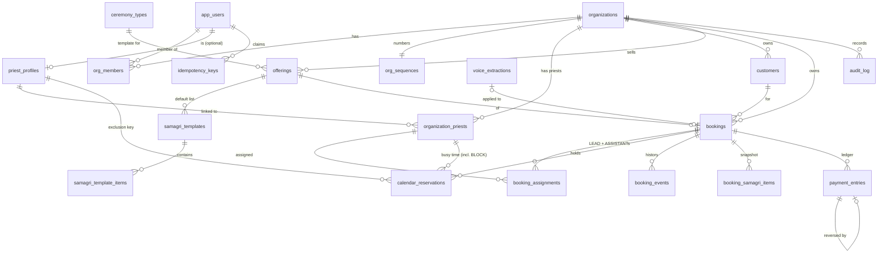

## 3. Table dictionary

| Table | Key columns and rules | Tenant-scoped |
| --- | --- | --- |
| `app_users` | `id` = auth uid at creation; `auth_user_id → auth.users ON DELETE SET NULL`; `preferred_locale hi/en`; `status ACTIVE/DELETED` | identity (own row) |
| `organizations` | `kind SOLO/COLLECTIVE`, unique `slug` (generated from the practice name, not editable, not shown in P0), validated IANA `timezone` (default `Asia/Kolkata`), `plan PILOT`, `voice_daily_limit` (default 30), `status`, `version` | is the tenant |
| `org_sequences` | per-org `next_booking_no` for `PD-YY-NNNN` (row-locked by `create_booking`; numbers never reused, not reset yearly; YY = year the booking is created; NNNN grows to 5+ digits after 9999) | yes |
| `org_members` | `(org_id, user_id)` unique; `role` OWNER/ADMIN/PRIEST/STAFF/READ_ONLY; `status` INVITED/ACTIVE/REVOKED; one ACTIVE OWNER per org (partial unique index) | yes |
| `priest_profiles` | global; `user_id` unique (one calendar per human) | global, visible via links |
| `organization_priests` | link org ↔ profile; default buffers; `linked_via BOOTSTRAP/INVITATION`; unique `(org_id, priest_profile_id)` and `(org_id, id, priest_profile_id)` | yes |
| `customers` | phone optional, **not unique** (shared household phones); `acquisition_source` immutable (PRIEST_DIRECT/IMPORT; P2 adds MARKETPLACE); `erased_at`; `version` | yes |
| `ceremony_types` | global catalog, read-only for the API | global |
| `offerings` | org's ceremonies; duration 15–1440 min; suggested dakshina (paise); unique name per org | yes |
| `samagri_templates`, `…_items` | ordered items, `provided_by FAMILY/PRIEST` | yes |
| `bookings` | see `docs/05`; `version`; CHECKs: start/end both or neither, ≤ 7 days, `local_date` = local date of start, CONFIRMED/COMPLETED need times, timestamps match status | yes |
| `booking_assignments` | one LEAD (partial unique index), ≤ 11 priests | yes |
| `calendar_reservations` | `span` (hard), `buffer_span ⊇ span`, `kind BOOKING/BLOCK`, `status ACTIVE/RELEASED`, `note` only on BLOCK rows; exclusion on `(priest_profile_id, span)` where ACTIVE; append-only except release | yes (cross-org reads only through `app_freebusy`) |
| `booking_events` | append-only history; `data` holds ids, times, amounts, codes — never free text | yes |
| `booking_samagri_items` | snapshot; template edits never change it | yes |
| `payment_entries` | append-only except erasing `note`/`external_ref` to NULL; RECEIPT > 0, REFUND < 0, REVERSAL = −(reversed amount), each entry reversed at most once, same booking | yes |
| `booking_balances` (view, `security_invoker`) | agreed, received (Σ entries), balance | yes |
| `voice_extractions` | status PROCESSING/READY/FAILED/APPLIED/DISCARDED; `audio_ms` 500–30000; transcript ≤ 4000; candidate JSON; cost estimate; `content_purged_at` | yes (own rows for runtime) |
| `idempotency_keys` | PK `(actor_user_id, key)`; `command`; `request_hash` (sha256 hex); `org_id` nullable (onboarding); response; expires 24 h | per actor |
| `audit_log` | identity PK; append-only except retention (> 12 months, maintenance role only) | yes (AUDIT_READ) |
| `role_permissions` | RBAC matrix (`docs/08`) | global |

Money is always `bigint` paise. Times are `timestamptz` (UTC) + `timezone` + `local_date`.

## 4. Tenant-aware foreign keys (EXECUTED `02`)

Every tenant table that other tenant tables reference has `UNIQUE (id, org_id)`, and every reference between tenant tables includes `org_id`, so a row can only point at a row of the same organization:

| Child | Composite reference |
| --- | --- |
| `bookings` | `(customer_id, org_id) → customers`, `(offering_id, org_id) → offerings` |
| `booking_assignments` | `(booking_id, org_id) → bookings`, `(organization_priest_id, org_id) → organization_priests` |
| `calendar_reservations` | `(org_id, organization_priest_id, priest_profile_id) → organization_priests` (also proves the profile matches the link), `(booking_id, org_id) → bookings` |
| `booking_events`, `booking_samagri_items`, `payment_entries` | `(booking_id, org_id) → bookings` |
| `payment_entries` | `(reverses_entry_id, booking_id) → payment_entries` (reversal on the same booking) |
| `samagri_templates` / items | `(offering_id, org_id)`, `(template_id, org_id) ON DELETE CASCADE` |
| `voice_extractions` | `(applied_booking_id, org_id) → bookings` |

## 5. Constraints and triggers that carry business rules

| Rule | Mechanism | Test |
| --- | --- | --- |
| No overlapping ceremony time per human, across organizations | `calendar_reservations_no_overlap` GiST exclusion | `04`, `concurrency.sh` |
| One active reservation per (booking, priest) | partial unique index | `05 › one ACTIVE reservation per (booking, priest)` |
| Booking state machine; immutable `org_id`, number, source, creator, channel | `tg_booking_guard` (PD410/PD422) | `03`, `05` |
| CONFIRMED/COMPLETED ⇔ one LEAD + covering ACTIVE reservations; DRAFT/CANCELLED ⇔ none | deferred constraint triggers `tg_booking_invariants` (PD500 at COMMIT) | `05` |
| Reservations are history | `tg_reservation_guard` (only ACTIVE→RELEASED; no DELETE) | `05` |
| Payments, events are append-only | `tg_append_only` on events (PD405); `tg_payment_guard` on payments (only `note`/`external_ref` → NULL) | `05`, `06 › ledger notes cannot be rewritten` |
| Customer provenance immutable | `tg_customer_source_immutable` | `05` |
| Optimistic concurrency | `tg_bump_version` on versioned tables; commands compare `p_expected_version` | `03` |
| Valid IANA time zones | `app.is_valid_timezone`: `Area/Location` (or `UTC`) form **and** recognised by PostgreSQL; abbreviations and POSIX strings rejected | `03 › unknown IANA timezone rejected`, `› time-zone abbreviations are rejected (IANA names only)` |
| Audit kept 12 months | `audit_log` guard allows DELETE only for `app_maintenance` and only > 12 months | `08` |

## 6. Indexes

`bookings(org_id, starts_at)` agenda; `bookings(org_id, customer_id, created_at DESC)`; `bookings(org_id, status, local_date)`; `customers(org_id, lower(display_name) text_pattern_ops)` prefix search; `customers(org_id, phone_e164)` partial; `calendar_reservations` GiST `(priest_profile_id, span)` (constraint) and `(priest_profile_id, buffer_span)` partial ACTIVE; `calendar_reservations(org_id, booking_id)`; `booking_events(org_id, booking_id, created_at)`; `org_members(user_id)` partial ACTIVE; `organization_priests(priest_profile_id)`. P0 volumes (≤ 10k bookings per org per year) need nothing more; re-check with `pg_stat_statements` at 100 organizations.

## 7. Roles, ownership and privileges

| Role | Login | Owns | Can do | Cannot do |
| --- | --- | --- | --- | --- |
| `app_runtime` | **yes** (API) | nothing | SELECT on tenant tables through RLS; EXECUTE on 27 commands, `get_booking`, `_booking_out`, the context helpers `current_actor_id`/`current_tenant_id` and 3 membership helpers used by its policies | any INSERT/UPDATE/DELETE/TRUNCATE (gate); call internal helpers or retention (`02`) |
| `app_domain` | no | command functions | the specific INSERT/UPDATE/DELETE each command needs, through RLS scoped to the current tenant | see other tenants; bypass RLS |
| `app_authz` | no | `current_member_role`, `current_member_has`, `is_active_member_of`, `current_priest_profile_id`, `assert_permission` | read only the actor's membership rows | anything else |
| `app_bootstrap` | no | `ensure_current_user`, `bootstrap_practice` | insert rows owned by the actor (`linked_via = 'BOOTSTRAP'`) | link other people; touch existing organizations |
| `app_freebusy` | no | `_priest_conflicts`, `priest_busy` | column-level SELECT on `id, org_id, priest_profile_id, booking_id, kind, status, span, buffer_span` of ACTIVE reservations in any org (no notes, creators); its two functions first verify the priest is linked to the caller's org and return other orgs' spans without ids | read bookings, customers, or anything else |
| `app_maintenance` | no | `run_retention` | purge transcripts, time out stuck voice jobs, delete expired idempotency keys and old audit rows | anything else; it is executable only by the migration owner (Supabase Cron) |
| `app_operator` (founder review, 29 Oct 2026) | no | `ops_add_member`, `ops_revoke_member` | add, re-role or revoke a non-owner membership (its policies admit no OWNER row); read organization ids/names/status and app user ids/status | anything else; executable only by the migration owner (operator scripts in `supabase/ops/`) |

Every SECURITY DEFINER function pins `search_path = ''` and schema-qualifies every name (gate). EXECUTE is revoked from PUBLIC on every function (gate). The migration owner (Supabase: `postgres`) is a member of an application role only inside the migration that hands functions to it, and revokes that membership before the migration ends; a GRANT on another role's object is checked by a DO block that raises if it granted nothing (founder review, 29 Oct 2026).

## 8. Row-level security

All tables ENABLE + FORCE RLS except the two global reference tables (`ceremony_types`, `role_permissions`: enabled, read-only policies). No policy targets PUBLIC (gate). The tenant predicate (written once, reused):

```sql
org_id = (SELECT app.current_tenant_id()) AND (SELECT app.current_member_role()) IS NOT NULL
```

The sub-selects make PostgreSQL evaluate each helper once per statement (InitPlan) instead of once per row. `current_member_role()` checks an ACTIVE membership of the actor in that tenant, so a forged `X-Tenant-ID` yields zero rows (EXECUTED `02`). Policies by role:

| Table group | `app_runtime` | `app_domain` | Others |
| --- | --- | --- | --- |
| Tenant tables | SELECT where T | ALL where T | `app_freebusy` SELECT ACTIVE reservations (any org; only reachable through its two functions, which check the link and strip ids); `app_maintenance` retention rows only |
| `voice_extractions` | SELECT own rows (`requested_by = actor`) where T | ALL where T | `app_maintenance` rows older than 10 minutes |
| `audit_log` | SELECT where T and `AUDIT_READ` | INSERT where T | `app_maintenance` DELETE > 12 months |
| `organizations` | SELECT where active member | UPDATE where T | `app_bootstrap` INSERT (created_by = actor) |
| `org_members`, `app_users`, `priest_profiles` | own rows anywhere + rows of the **current** tenant (if the actor is an active member) | scoped | `app_bootstrap` own rows; `app_authz` own memberships |
| `idempotency_keys` | none | own rows; erasure scrub of tenant rows when `CUSTOMER_ERASE` | `app_bootstrap` own rows; `app_maintenance` expired |

## 9. Request context

The API sets two transaction-local settings at the start of every transaction and nothing else:

```sql
SELECT set_config('app.actor_user_id', $1, true), set_config('app.tenant_id', $2, true);
```

`is_local = true` means they vanish at COMMIT/ROLLBACK, so a pooled connection never carries a previous request's identity. Empty or missing settings make every helper return NULL, every tenant policy false and every tenant command raise PD401 (EXECUTED `02`); the identity commands (`ensure_current_user`, `bootstrap_practice`, `update_my_profile`) need an actor but no tenant. The actor id comes only from the verified Supabase JWT `sub`.

## 10. Seed data

`supabase/seed/ceremony_types.sql`: 20 common North-Indian ceremonies (Griha Pravesh, Satyanarayan Katha, Mundan, Namkaran, Rudrabhishek, Havan, …) with Hindi names; Punjabi names are NULL until P1. Upsert on `slug`, safe to re-run. Pilot organizations get offerings from the slugs the priest picks during onboarding (at least one). Revision 2.1: the full list of 20 is proposed in `docs/plan.md` M1 for the founder to correct.

## 11. P1/P2 schema evolution (not built)

| Phase | Additions | Compatibility |
| --- | --- | --- |
| P1 | `member_invitations` (token hash, expiry, role), `priest_link_invitations` + `accept_priest_invitation()` executed by the invited priest; `customer_consents`; `outbox` + `app_worker` role; `public_links` (hashed tokens) + `app_public` role; `billing.*`; `bookings.status` adds INQUIRY | Additive; widen CHECKs; new roles follow §7 pattern |
| P2 | `market` schema: listings, leads, quotes, reviews, settlement references; `acquisition_source`/`source` add MARKETPLACE | Separate schema and roles; never reads PRIEST_DIRECT customers |

---

# 05 — Booking Engine

Implementation: `supabase/migrations/…000400` (tables, guard, invariants) and `…000700` (commands). Tests: `03_booking_lifecycle.sql`, `04_conflicts_buffers_multipriest.sql`, `05_database_guards.sql`, `09_idempotency.sql`, `concurrency.sh`.

## 1. Lifecycle

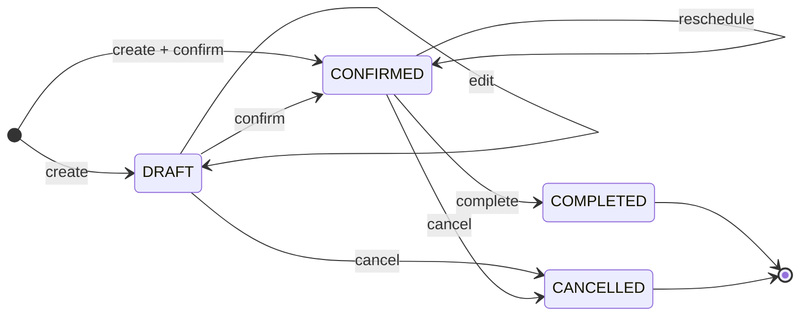

Edges: *create* = `create_booking`; *confirm* reserves every assigned priest; *reschedule* releases and re-reserves atomically (event RESCHEDULED, no stored state); *complete* only after `starts_at`; *cancel* from CONFIRMED needs a reason (≥ 3 chars) and releases the slots.

| From → To | Command | Permission | Reservation effect | Guarded by |
| --- | --- | --- | --- | --- |
| — → DRAFT | `create_booking` | BOOKING_CREATE | none | command |
| — → CONFIRMED | `create_booking` with `confirm` | BOOKING_CREATE + (BOOKING_CONFIRM or BOOKING_CONFIRM_OWN as LEAD) | reserve all assigned priests | command + invariants |
| DRAFT → CONFIRMED | `confirm_booking` | BOOKING_CONFIRM or _OWN | reserve all | guard + invariants |
| DRAFT → CANCELLED | `cancel_booking` | BOOKING_CANCEL or _OWN | none | guard |
| CONFIRMED → CONFIRMED (move) | `reschedule_booking` | BOOKING_CONFIRM or _OWN | release old + reserve new, atomically | invariants |
| CONFIRMED → COMPLETED | `complete_booking` | BOOKING_COMPLETE or _OWN | **kept ACTIVE** as historical busy time | guard + invariants |
| CONFIRMED → CANCELLED | `cancel_booking` | BOOKING_CANCEL or _OWN | release all | guard + invariants |
| COMPLETED/CANCELLED → anything | — | — | — | guard (PD410); only `notes`, and erasure of free text, may change |

`_OWN` means the actor is the booking's LEAD priest (PRIEST role). It is checked **before and after** any `priest_ids` change, so a PRIEST cannot take over another priest's booking by reassigning it (EXECUTED `04 › PRIEST cannot take over another priest's booking by reassigning it while confirming`, `› PRIEST cannot reassign another priest's draft to himself`). STAFF may assign priests to drafts but cannot confirm. The TypeScript mirror is `BOOKING_TRANSITIONS` in `src/domain/types.ts`.

Editing rules (`update_booking`): while DRAFT every field may change (title, customer, offering, location, notes, dakshina, times, date, tentative flag, buffers, priests). Once CONFIRMED, schedule fields (times, date, timezone, tentative, buffers, priests) are rejected with `VALIDATION_FAILED reason=use_reschedule`. Unknown fields are rejected.

## 2. Double-booking prevention (hard guarantee)

1. Busy time lives only in `calendar_reservations`, one row per (booking, assigned priest) or per calendar block.
2. `EXCLUDE USING gist (priest_profile_id WITH =, span WITH &&) WHERE status = 'ACTIVE'` — keyed on the **global** priest profile, so it holds across organizations.
3. `span` is the ceremony window `[starts_at, ends_at)`; half-open, so 09:00–12:00 and 12:00–13:00 do not conflict.
4. The constraint cannot be bypassed: the API role cannot write tables; every BOOKING reservation is inserted by `_reserve_booking`, every BLOCK by `create_block` (same per-priest advisory lock, no buffer check); there is no override flag.
5. The deferred invariant triggers make it impossible to commit a CONFIRMED/COMPLETED booking without covering reservations for every assigned priest, or a DRAFT/CANCELLED booking that still holds one (PD500).

Concurrency (EXECUTED, `concurrency.sh`): two sessions confirming the same priest at overlapping times in **different organizations** — the second waits (~1.2 s in the harness, which holds the first transaction open) and then fails with `BOOKING_CONFLICT`; if the first rolls back, the second commits. Run 3 times, plus a rollback variant, a buffer-only race and an idempotency race; zero overlapping ACTIVE reservations remain.

## 3. Reservation algorithm (`_reserve_booking`)

```
input: booking b (status DRAFT→CONFIRMED, or CONFIRMED being moved), ack flag
span        := [b.starts_at, b.ends_at)
buffer_span := [b.starts_at − buffer_before, b.ends_at + buffer_after)
for each assigned priest, ORDER BY priest_profile_id:          -- fixed order: no deadlocks
    pg_advisory_xact_lock(hash(priest_profile_id))              -- serialises buffer checks per human
for each assigned priest:
    conflicts := _priest_conflicts(profile, span, buffer_span, exclude b)   -- app_freebusy, all orgs
        CEREMONY if other.span && span
        BUFFER   if other.span && buffer_span OR other.buffer_span && span (and not CEREMONY)
if any CEREMONY → raise 23P01 BOOKING_CONFLICT {conflicts: times; booking_id only if same org}
if any BUFFER and not ack → raise PD449 BUFFER_CONFLICT {conflicts}
insert one ACTIVE reservation per assigned priest (span, buffer_span)  -- exclusion constraint = final arbiter
return acknowledged buffer conflicts (stored on booking + BUFFER_OVERLAP_ACKNOWLEDGED event)
```

Conflict details never contain another organization's booking id, customer, title or location (EXECUTED `04`: "org B sees only busy spans of org A, never its booking ids").

## 4. Cross-organization priests

A priest serving his own practice and a collective has **one** `priest_profiles` row and one `organization_priests` link per organization. All reservations carry the global `priest_profile_id`, so a confirmation in either organization sees the other's busy time (as anonymous spans). `GET /availability?priest_id=` returns those spans with `same_org=false` and no ids.

In P0 the only link is the priest's own practice (BOOTSTRAP). Linking to another organization requires the priest's acceptance (P1 `accept_priest_invitation`); the API role has no INSERT on links (EXECUTED `02`).

## 5. Multi-priest bookings

- `priest_ids` (organization_priest ids, max 11, distinct, ACTIVE links of this org): first = LEAD, others ASSISTANT. Exactly one LEAD is enforced by a partial unique index and the invariants.
- Confirmation reserves all priests or none: one busy priest fails the whole request (EXECUTED `04`: "no partial reservation for the free priest").
- Changing priests on a CONFIRMED booking goes through `reschedule_booking` (same times, new `priest_ids`).
- Drafts may have no priest (collective staff drafts first, assigns later); confirming requires a LEAD (EXECUTED `04 › confirming requires a LEAD priest`, `› STAFF may assign a priest to a draft (but cannot confirm it)`).

## 6. Travel buffers and intentional overrides

- Each priest link has default buffers (30/30 min); a booking copies the LEAD's defaults unless the request sets its own (0–360 min each).
- Ceremony overlap: always refused. There is no override.
- Buffer-only overlap: refused with `BUFFER_CONFLICT` and the list of overlapping spans. The UI shows "You have 15 minutes to travel from Sector 70 to Zirakpur. Continue?" and re-sends with `ack_buffer_overlap=true`. The booking stores `buffer_overlap_ack=true` and the history stores `BUFFER_OVERLAP_ACKNOWLEDGED` with the spans (EXECUTED `04`).
- Reschedule resets the acknowledgement; a new overlap must be acknowledged again.

## 7. Uncertain dates and times

| Situation | Representation | Rule |
| --- | --- | --- |
| Date known, time not fixed ("1 Nov, time later") | DRAFT with `local_date`, no `starts_at` | Cannot be confirmed until a time is set; shown in the agenda's "time to fix" list. |
| Time window ("morning, exact muhurat later") | CONFIRMED with `starts_at..ends_at` = the whole window and `is_time_tentative=true` | The whole window is reserved; UI shows "≈"; follow-up reminder in P1. |
| Lunar date ("Kartik Purnima") | Voice/manual draft with an ambiguity flag; no conversion | The priest picks the Gregorian date; no Panchang engine in P0/P1. |
| Overnight (Jagran 22:00–06:00), multi-day (Bhagwat Katha) | One booking, `ends_at > starts_at`, ≤ 7 days | `local_date` = date of the start; longer events are separate bookings. |
| Relative phrases in voice ("agle Sunday") | Resolved in TS against the utterance time; ambiguity offers both dates | `docs/06`. |

## 8. Calendar blocks

`create_block(priest, starts_at, ends_at, note)` inserts a `BLOCK` reservation (≤ 31 days) that competes in the same exclusion constraint; `release_block` releases it (history kept). Permission BLOCK_MANAGE, or BLOCK_MANAGE_OWN for the priest's own calendar (EXECUTED `04`).

## 9. Idempotency

- Every command that changes bookings, customers, catalog, calendar, ledger or settings takes `(p_idem_key, p_request_hash)` (the gate `contract: commands taking an idempotency key require Idempotency-Key` ties this to the API). Exempt by design: `prepare_share` and `begin_export` (they only log), `update_my_profile` (last-write-wins on one's own name/locale), `ensure_current_user` (naturally idempotent), and `finish_/discard_voice_extraction` (state-guarded: only PROCESSING→READY/FAILED and READY/FAILED→DISCARDED). The API computes the hash as SHA-256 of `METHOD + path + canonical JSON body`.
- The key is **claimed inside the command's transaction** before any work: `INSERT … ON CONFLICT (actor_user_id, key) DO NOTHING`. A concurrent duplicate waits on the uncommitted insert, then sees the committed row and replays (EXECUTED `concurrency.sh`: one booking, one replay).
- Replay returns the stored response plus `idempotent_replay: true`. Same key with a different command, body hash or tenant → `IDEMPOTENCY_REUSE` (409). A stored response scrubbed by customer erasure → `IDEMPOTENCY_REUSE` with `details.reason = original_response_erased`.
- If the command fails, its transaction rolls back including the key claim, so the client may retry with the same key.
- Keys expire after 24 h and are deleted by the hourly retention job.

## 10. Optimistic concurrency

Versioned resources (bookings, customers, offerings, samagri templates, organizations) return `version` and an `ETag: "<version>"`. Mutations require `If-Match`; a stale version → `VERSION_CONFLICT` (409) with `details.current_version` (EXECUTED `03`). Commands lock the row (`SELECT … FOR UPDATE`) before comparing.

## 11. Auditability

| Record | Contents | Mutability |
| --- | --- | --- |
| `booking_events` | CREATED, EDITED (field names only), CONFIRMED, RESCHEDULED (from/to times, reason code), CANCELLED (count released), COMPLETED, BUFFER_OVERLAP_ACKNOWLEDGED, SAMAGRI_ATTACHED, SHARE_PREPARED, PAYMENT_RECORDED/REVERSED, PII_ERASED; actor, timestamp | append-only, no free text |
| `calendar_reservations` | every hold ever made, with release time | ACTIVE→RELEASED only |
| `payment_entries` | every money record | append-only; only `note`/`external_ref` may be erased to NULL |
| `audit_log` | organization-level actions (org updated, block created, customer erased, export started) | append-only; purged after 12 months |

---

# 06 — AI and Voice Architecture

Principle: **the model proposes phrases; deterministic code interprets them; the priest decides; the database accepts only a normal booking command.** Voice is the last P0 feature, behind a per-organization flag, and starts only after the evaluation spike (T-15) passes.

## 1. Workflow

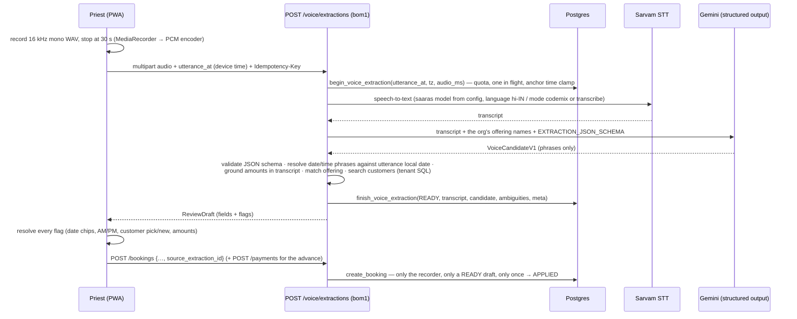

Audio lives only in the request's memory; it is never written to storage or logs. If STT or LLM fails, `finish_voice_extraction(FAILED, error_code)` and the UI offers the manual form pre-filled with whatever was extracted; a stuck PROCESSING row is timed out by retention after 10 minutes.

## 2. Contracts

| Artifact | Location | Notes |
| --- | --- | --- |
| Extraction schema | `src/domain/voice/candidate.ts` (`VoiceCandidateV1`, `EXTRACTION_JSON_SCHEMA`) | `additionalProperties:false` everywhere; every field has `status ∈ explicit/inferred/not_mentioned/unclear`; no ids; phone only as spoken digits. |
| Date resolver | `voice/resolve-date.ts` | aaj/kal/parso, weekdays (Hindi, Hinglish, Devanagari, English), "agle/is/pichhle", explicit dates, "15 tarikh"; ambiguity codes RELATIVE_WEEKDAY, WEEKDAY_TODAY_OR_NEXT_WEEK, DAY_OF_MONTH_ONLY, HINDU_CALENDAR_REFERENCE, UNRESOLVED. |
| Time resolver | `voice/resolve-time.ts` | subah/dopahar/shaam/raat; saadhe/sava/paune/dedh/dhai; 24 h; AM_PM ambiguity when no part of day. |
| Amount grounding | `voice/amounts.ts` | An amount is accepted only if it literally appears in the transcript (digits, "51 sau", "11 हज़ार"); otherwise AMOUNT_UNVERIFIED. |
| Review draft | `voice/review-draft.ts` | Never applies a fuzzy customer match; flags MULTIPLE_MATCHES / NO_MATCH_NEW_CUSTOMER; defaults duration from the offering with a flag. |
| DB lifecycle | `begin_/finish_/discard_voice_extraction`, `create_booking(source_extraction_id)` | EXECUTED `07` (13 assertions) and `08` (purge). |
| API | `POST /voice/extractions`, `GET /voice/extractions/{id}`, `POST …/discard` | `api/openapi.yaml`. |

Reference utterance (Monday 26 Oct 2026): *"Agle Sunday Sharma ji ki Griha Pravesh puja Sector 79 Mohali mein subah 9 baje hai. Dakshina 5100 aur advance 1100 mil gaya."* → date chips 1 Nov / 8 Nov (RELATIVE_WEEKDAY), 09:00, Griha Pravesh (180 min, flagged as defaulted), customer choice (existing "Rajesh Sharma, Sector 79" offered, not applied), ₹5,100 agreed, ₹1,100 advance (EXECUTED `domain.test.ts`).

## 3. Safety controls

| Risk | Control | Status |
| --- | --- | --- |
| Model invents a date ("next Sunday" → wrong week) | Model returns the phrase only; TS resolves against the **utterance** local date; ambiguity forces a choice | EXECUTED (unit tests) |
| Model invents an amount | Grounding check against the transcript | EXECUTED |
| Wrong customer attached | Model never sees customer records; matches are offered, never applied | EXECUTED |
| Prompt injection in speech ("ignore instructions…") | Structured output with a closed schema; no tools; output only fills fields the priest reviews | DESIGN |
| Silent write | Extraction cannot write bookings; only `create_booking` by the recorder, once, from READY | EXECUTED `07` |
| Device clock wrong | `utterance_at` accepted only within −15/+2 min of server time, else server time | EXECUTED `07` |
| Cost runaway | `voice_daily_limit` per org (default 30), one PROCESSING per user, 30 s cap, 1.2 MB body cap | EXECUTED (quota) / DESIGN (body cap) |
| Personal data to vendors | Only the transcript and offering names go to the LLM; paid tier (not used for training); transcripts purged after 7 days; audio not stored | DESIGN + EXECUTED (purge) |
| Vendor/model retirement | Model ids only in env config; adapters behind interfaces; no shutdown date announced for Gemini 2.5 Flash as of 27 Oct 2026 | DESIGN |

## 4. Provider abstraction

```ts
// src/adapters/types.ts  (interfaces from the original pack, not supplied; voice is out of scope until M14)
export interface SpeechToText {
  transcribe(input: { wav: Uint8Array; languageHint: 'hi-IN' | 'en-IN' | 'pa-IN' | 'auto' }):
    Promise<{ transcript: string; languageCode: string | null; provider: string; model: string; audioMs: number }>;
}
export interface CandidateExtractor {
  extract(input: { transcript: string; offeringNames: string[]; schema: object }):
    Promise<{ candidate: unknown; provider: string; model: string; inputTokens: number; outputTokens: number }>;
}
```

Implementations: `SarvamSpeechToText` (`POST https://api.sarvam.ai/speech-to-text`, model from `STT_MODEL`, e.g. `saaras:v4` default per Sarvam docs) and `GeminiExtractor` (`LLM_MODEL=gemini-2.5-flash`, fallback `gemini-2.5-flash-lite`). A second STT adapter is evaluated in the spike but not built unless Sarvam fails the gate.

## 5. Cost model (verified prices, 27 Oct 2026; exchange rate assumption ₹88/USD)

| Item | Per 20-second note |
| --- | --- |
| Sarvam STT ₹0.49/min, billed per second, + 18% GST | ₹0.16 + GST ≈ ₹0.19 |
| Gemini 2.5 Flash: ~1,200 input tokens ($0.30/M) + ~300 output ($2.50/M) | ≈ $0.0011 ≈ ₹0.10 |
| **Total** | **≈ ₹0.30** |

| Usage | Notes/month | Cost/month |
| --- | --- | --- |
| Pilot: 10 priests × 3/day | 900 | ≈ ₹270 |
| 50 priests × 5/day | 7,500 | ≈ ₹2,250 |
| 500 priests × 5/day | 75,000 | ≈ ₹22,500 (re-negotiate / Flash-Lite) |

`voice_extractions.est_cost_paise` records the estimate per note so actual spend can be reconciled weekly against vendor dashboards.

## 6. Evaluation and testing strategy

1. **Unit tests (CI, free):** resolvers, grounding, review-draft mapping — `domain.test.ts` (13 tests) grows with every bug found in real notes.
2. **Recorded corpus (spike T-15, before any voice ticket):** ≥ 50 consented recordings from ≥ 5 priests (Hindi, Hinglish, some Punjabi-accented), with hand-written expected fields. Store recordings encrypted, outside the product, with written consent; delete after the evaluation.
3. **Metrics:** exact match per field (date phrase, time, ceremony, amounts, locality); **catastrophic error rate** = a confidently wrong date/time/amount with no flag. Gate: catastrophic ≤ 2%, date-phrase capture ≥ 90%, amounts ≥ 95%; otherwise voice stays off.
4. **Regression:** the corpus runs nightly or on demand (`npm run eval:voice`), never on every PR (paid calls).
5. **Pilot telemetry:** per-field edit rate on the review screen (how often the priest changed what the model proposed), without storing the transcript beyond 7 days.

---

# 07 — Messaging and Communication

## 1. P0: manual WhatsApp sharing (built)

| Step | Where | Detail |
| --- | --- | --- |
| 1 | `POST /bookings/{id}/share?locale=hi` | Calls `app.prepare_share` (permission SHARE_MESSAGE): returns the booking, the customer's name/phone and the samagri snapshot; logs `SHARE_PREPARED` (channel `WHATSAPP_MANUAL`). |
| 2 | `renderBookingMessage()` (`src/domain/share/whatsapp.ts`) | Hindi or English text: booking number, ceremony, date/time in the booking's time zone ("≈" when tentative), place, dakshina agreed/received/balance with Indian digit grouping, and **only** samagri the family must arrange. Max 1,800 characters; long samagri lists are trimmed first, essentials never. |
| 3 | Client | `waMeUrl(phone, text)` → `https://wa.me/91XXXXXXXXXX?text=…` (no "+"), or the Web Share API when there is no phone (forward to a family group). |
| 4 | Priest | Sends from his own WhatsApp. PurohitDesk never knows whether it was delivered and never claims so. |

Tests: `domain.test.ts` (Hindi rendering, ₹ grouping, family-only samagri, URL encoding, 1,800-character cap). No consent record is needed in P0 because the priest sends from his own account to people who contacted him; the privacy notice still states that booking details may be shared by the priest via WhatsApp.

## 2. P1: official WhatsApp Business Platform (design only)

Trigger to build: pilot priests ask for automatic reminders and the cost per message is acceptable (`docs/10`).

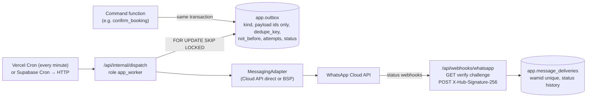

| Concern | Design |
| --- | --- |
| Outbox | Rows written by command functions in the booking transaction (no dual write). Payload holds ids only; the worker renders text at send time from current data (so erased data is never sent). |
| Worker privileges | New NOLOGIN owner `app_worker` for `dispatch_due_messages(limit)`; the dispatch endpoint logs in as `app_runtime` and calls only that function (EXECUTE granted), authenticated by a shared secret header from the scheduler. No BYPASSRLS: the function sets the tenant per row through role-scoped policies. |
| Consent | `customer_consents(customer_id, channel, purpose TRANSACTIONAL/REMINDER/MARKETING, granted_at, source, withdrawn_at)`. No message without an active consent for its purpose; marketing is out of scope for P1. Opt-out keywords (STOP/रोकें) handled by the webhook. |
| Templates | Utility templates per language (booking confirmation, reminder T−1 day, samagri list), approved in Meta Business Manager; template name + language in config. |
| Retries | Exponential backoff (1, 5, 30 min, 2 h), max 5 attempts, then FAILED and visible to the priest; idempotent by `dedupe_key` (e.g. `reminder:<booking>:<date>`). |
| Webhooks | GET `hub.challenge` verification with a verify token; POST verified with `X-Hub-Signature-256` (HMAC-SHA256, app secret) before parsing; idempotent upsert by `wamid`; no bearer auth on this path (Meta cannot send one). |
| Delivery records | `message_deliveries` (sent/delivered/read/failed with timestamps, error code), retained 12 months, no message bodies stored. |
| Sender identity | **VERIFY with Meta/BSP before building:** whether one platform-owned number may send on behalf of many independent priests, or each priest needs his own number/WABA (embedded signup). This decides onboarding complexity and cost. |
| SMS fallback | Not planned. Any SMS needs TRAI DLT registration (VERIFY). |

## 3. Cost (Meta pricing after 1 Oct 2026)

Meta resumed charging utility templates sent inside the customer-service window on 1 Oct 2026 ([Meta pricing](https://developers.facebook.com/documentation/business-messaging/whatsapp/pricing.md)). Rates below are a BSP's published India card ([AiSensy](https://m.aisensy.com/blog/whatsapp-pricing-update-october-2026/)), a secondary source: utility ≈ ₹0.145, marketing ≈ ₹1.09 per message, before BSP margins and GST.

| Usage | Utility messages/month (confirmation + reminder + samagri ≈ 3/booking) | Meta cost/month |
| --- | --- | --- |
| 50 priests × 40 bookings | 6,000 | ≈ ₹870 |
| 500 priests × 40 bookings | 60,000 | ≈ ₹8,700 |

## 4. Notification architecture beyond WhatsApp (P1)

In-app notifications (agenda badges: "3 bookings need a time", "balance due") are computed by queries, not stored. Web Push is optional in P1 for reminders to the priest himself (no consent issue, no per-message cost). Email is used only for account/security events through Supabase Auth.

---

# 08 — Security and Privacy

## 1. Authentication

| Item | Decision |
| --- | --- |
| Identity provider | Supabase Auth. P0: Google sign-in. Phone OTP only after confirming SMS provider, India DLT registration and cost (VERIFY). |
| Token handling | The PWA holds the Supabase session (httpOnly cookie via `@supabase/ssr`). Every API request is verified server-side (signature via JWKS, `exp`, `aud`); the actor id is the token `sub`. |
| Tenant selection | `X-Tenant-ID` header per request; never stored in the token. Membership is re-checked by the database on every statement, so revocation is immediate (EXECUTED `02`). |
| First login | `GET /session` → `app.ensure_current_user` (owner `app_bootstrap`) creates `app_users` only if the actor exists in `auth.users`, proven by the `auth_user_id` foreign key: no application role reads `auth.users`. The display name is passed in from the verified token's `user_metadata` as untrusted display text (founder review, 29 Oct 2026). |
| Sessions | Supabase defaults (1 h access token, refresh rotation); "sign out everywhere" via Supabase. |
| Account deletion | Operator runbook (`supabase/ops/runbook.md`): export on request → delete the Supabase auth user → `app_users.auth_user_id` becomes NULL (FK `ON DELETE SET NULL`), status DELETED; history stays consistent and the identity can no longer sign in (EXECUTED `08`). A SOLO owner's organization is closed and its customers erased on request. |

## 2. Authorization model

Three layers, each sufficient to stop a cross-tenant read or write on its own:

1. **API**: verified JWT; Zod validation; membership probe per request (`withTenantTx`, 404 for non-members).
2. **Command functions**: `assert_permission(p)` against `app.role_permissions`; `_OWN` variants check that the actor is the booking's LEAD priest; version checks; validation.
3. **Row-level security + privileges**: FORCE RLS with membership predicates; the login role cannot write any table; command owners are NOLOGIN, non-BYPASSRLS, and see only the current tenant — except `app_freebusy`, which reads busy-time columns of other organizations' reservations and returns them anonymised.

### RBAC permission matrix (source: `app.role_permissions`; regenerate with `python3 tools/render_tables.py rbac`)

| Permission | OWNER | ADMIN | PRIEST | STAFF | READ_ONLY |
| --- | :---: | :---: | :---: | :---: | :---: |
| `ORG_READ` | ✓ | ✓ | ✓ | ✓ | ✓ |
| `ORG_SETTINGS` | ✓ | ✓ | · | · | · |
| `MEMBER_MANAGE` | ✓ | · | · | · | · |
| `AUDIT_READ` | ✓ | ✓ | · | · | · |
| `EXPORT_DATA` | ✓ | ✓ | · | · | · |
| `CUSTOMER_READ` | ✓ | ✓ | ✓ | ✓ | ✓ |
| `CUSTOMER_WRITE` | ✓ | ✓ | ✓ | ✓ | · |
| `CUSTOMER_ERASE` | ✓ | ✓ | · | · | · |
| `CATALOG_WRITE` | ✓ | ✓ | · | · | · |
| `BOOKING_READ` | ✓ | ✓ | ✓ | ✓ | ✓ |
| `BOOKING_CREATE` | ✓ | ✓ | ✓ | ✓ | · |
| `BOOKING_EDIT` | ✓ | ✓ | ✓ | ✓ | · |
| `BOOKING_CONFIRM` | ✓ | ✓ | · | · | · |
| `BOOKING_CONFIRM_OWN` | · | · | ✓ | · | · |
| `BOOKING_CANCEL` | ✓ | ✓ | · | · | · |
| `BOOKING_CANCEL_OWN` | · | · | ✓ | · | · |
| `BOOKING_COMPLETE` | ✓ | ✓ | · | · | · |
| `BOOKING_COMPLETE_OWN` | · | · | ✓ | · | · |
| `BLOCK_MANAGE` | ✓ | ✓ | · | · | · |
| `BLOCK_MANAGE_OWN` | · | · | ✓ | · | · |
| `PAYMENT_RECORD` | ✓ | ✓ | ✓ | ✓ | · |
| `PAYMENT_REVERSE` | ✓ | ✓ | · | · | · |
| `SHARE_MESSAGE` | ✓ | ✓ | ✓ | ✓ | · |
| `VOICE_USE` | ✓ | ✓ | ✓ | ✓ | · |

Notes: MEMBER_MANAGE has no P0 endpoint (invitations are P1). PRIEST acts on bookings he leads through the `_OWN` permissions, checked before and after any priest reassignment (no takeover; EXECUTED `04`); he may edit details (notes, place) of any booking of the organization through BOOKING_EDIT. READ_ONLY sees everything in the tenant except the audit log. Per-endpoint permissions are listed in `docs/11` §2 and in `api/openapi.yaml` (`x-permission`); the gate `rbac: every x-permission names a real permission` checks them.

## 3. Database roles and privileged paths (no BYPASSRLS anywhere)

| Privileged need | Earlier defect | Control | Test |
| --- | --- | --- | --- |
| Create the first organization before any membership exists | B1: needed BYPASSRLS | `app_bootstrap` owns `bootstrap_practice`; policies let it insert only rows `created_by = actor`, OWNER membership for itself, BOOTSTRAP link to its own profile; ≤ 3 orgs per user | `01` (11) |
| Detect another organization's bookings of the same priest | B2/B3 | `app_freebusy` owns `_priest_conflicts`/`priest_busy`; verifies the priest is linked to the caller's org; returns spans only, ids only for own org | `04` |
| Members with other roles in P0 (no UI) | operator scripts lifted FORCE RLS (founder review, 29 Oct 2026) | `app_operator` owns `ops_add_member`/`ops_revoke_member`, executable only by the migration owner; its policies admit no OWNER row; scripts are one call each and print ids only | M2 `03_ops_members` |
| Retention purge | B7 (blocked by immutability) | `app_maintenance` owns `run_retention`; its policies admit voice rows older than 10 minutes, expired idempotency keys and audit rows older than 12 months, and the function's WHERE clauses apply the 7-day/24-hour limits; executable only by the migration owner (Supabase Cron) | `08`, `02` (runtime cannot run it) |
| Background worker (P1) | B8 (no role) | Pattern: `app_worker` NOLOGIN owner of one dispatch function, role-scoped policies on `outbox` | DESIGN |
| Public pages (P1) | A: undefined | Pattern: `app_public` owns `get_public_receipt(token)`; tokens are 32 random bytes, stored as SHA-256, expire (30 days), revocable, scoped to one booking; returns a minimal projection (no phone, no address beyond locality) | DESIGN |

Gates that keep this true (EXECUTED, `tools/check_consistency.py`): no app role has BYPASSRLS or SUPERUSER; every SECURITY DEFINER function has a pinned `search_path` and a NOLOGIN, non-BYPASSRLS owner; no app function is executable by PUBLIC; `app_runtime` has no INSERT/UPDATE/DELETE/TRUNCATE; every function `app_runtime` may execute is either an endpoint function or used by its own RLS policies; RLS enabled on every app table and forced on every tenant/identity table; no policy applies to PUBLIC.

## 4. Threat model (P0)

| Threat | Control | Status |
| --- | --- | --- |
| Tenant A reads/writes tenant B (IDOR, forged header) | RLS membership predicate; composite FKs; 404 not 403 | EXECUTED `02` |
| Route handler bug writes without a check | Login role has no DML; commands check permissions | EXECUTED gate + `02` |
| SQL injection | Tagged-template parameters only; no string-built SQL in TS; definer functions use `format(%I/%L)` only in migrations | DESIGN + review |
| Stolen JWT | Short expiry; revocation by membership; device sign-out | DESIGN |
| Cross-site request forgery with the session cookie | Cookie-authenticated writes and sign-out need `Sec-Fetch-Site: same-origin` (or a matching `Origin`); bodies must be `application/json`; `SameSite=Lax` cookies (founder review, 29 Oct 2026) | unit + integration tests (M2) |
| Connection-pool context leak | `set_config(…, true)` inside one transaction; missing context ⇒ no rows / PD401 | EXECUTED `02`; pooler behaviour VERIFY (T-04) |
| Priest linked without consent | No INSERT on links for runtime; BOOTSTRAP only via bootstrap role | EXECUTED `02` |
| Double booking via race | Exclusion constraint + advisory locks | EXECUTED `concurrency.sh` |
| Conflict errors leak other orgs' data | Conflict details carry times only; PostgreSQL DETAIL dropped except our own JSON | EXECUTED `04` + unit test |
| CSV formula injection in exports | Prefix `'` to cells starting with `= + - @` | DESIGN (T-09 test) |
| Voice prompt injection / hallucination | Closed schema, no tools, phrases only, human confirmation | EXECUTED (parts) `docs/06` |
| Abuse/cost (voice, onboarding) | Per-org voice quota, one in flight, org cap per user; Vercel WAF rate limit per IP on `/api` | EXECUTED (DB quotas) / DESIGN (WAF) |
| Secrets exposure | Secrets only in Vercel/Supabase env; `app_runtime` password rotated quarterly; no service-role key in the web app | DESIGN |

## 5. Data protection, retention, export and deletion

| Data | Retention | Mechanism |
| --- | --- | --- |
| Voice audio | Not stored | In-memory only |
| Voice transcripts and candidates | 7 days, or immediately on discard/erasure | `run_retention`, `discard_voice_extraction`, `erase_customer` |
| Idempotency responses | 24 h; scrubbed on erasure | `run_retention`, `erase_customer` |
| Audit log | 12 months (security events; CERT-In asks for 180 days of logs) | `run_retention` |
| Customers and bookings | While the priest's account is active; erasure on request | `erase_customer` (pseudonymise + scrub free text; amounts and busy time kept for the priest's accounts) |
| Booking history, ledger, reservations | Lifetime of the organization | append-only; `booking_events`/`audit_log` hold no free text; ledger `note`/`external_ref` are erased with the customer; block notes are the priest's own |
| Backups | Supabase daily (7 days on Pro) + weekly encrypted dump (30 days) | Erased data disappears from backups as they rotate (documented in the privacy notice) |

Export: `GET /exports/{customers|bookings|payments}.csv` (EXPORT_DATA), audited (`EXPORT`), formula-escaped.

## 6. Indian regulatory considerations (research notes as of 27 Oct 2026 — not legal advice; confirm with counsel)

| Area | What applies | What PurohitDesk does | Status |
| --- | --- | --- | --- |
| DPDP Act 2023 + DPDP Rules 2025 | Phased: Rule 4 (consent managers) ~13 Nov 2026; core obligations (notice, consent, security safeguards, breach notification, erasure, grievance) ~13 May 2027; a Removal of Difficulties Order (Oct 2026) reportedly made textual changes only ([Mondaq](https://www.mondaq.com/dpdp-act-and-rules-2025-the-2026-compliance-milestones-businesses-cant-afford-to-miss/1830402), [India Briefing](https://www.india-briefing.com/news/dpdp-removal-of-difficulties-order-2026-consent-data-audit-47274.html/)) | Design assumption to confirm: the **priest is the Data Fiduciary** for his customers' data and PurohitDesk is his **Data Processor**; PurohitDesk is fiduciary for priests' own account data. Built now: minimisation, erasure, export, retention, audit, India-region hosting. Before May 2027: privacy notice in Hindi/English, processor terms with each priest, breach-response runbook (intimate the Board and affected people without delay; detailed report within 72 h — our reading of the breach rule, to confirm), grievance contact. | VERIFY with counsel |
| CERT-In Directions (2022) | Report specified incidents within 6 hours; keep ICT logs 180 days in India; synchronise clocks | Incident runbook; Supabase/Vercel logs + audit log retention ≥ 180 days (audit 12 months); NTP is provider-managed | DESIGN; VERIFY log retention on chosen plans |
| Cross-border transfer | DPDP allows transfer except to notified countries | Data at rest in Mumbai; transcripts sent to Gemini (US) — disclosed in privacy notice | VERIFY |
| TRAI TCCCPR (DLT) | Commercial SMS needs DLT registration | No SMS in P0; OTP only after DLT clarity | VERIFY |
| Consumer Protection (E-Commerce) Rules 2020 | Apply to marketplace (P2) | Not in P0/P1 scope | P2 |
| RBI payment aggregator rules | Holding/settling third-party funds needs a licensed PA | PurohitDesk never holds funds; P2 uses a licensed PSP's split product | P2 |
| GST | SaaS subscriptions (P1) | Register when turnover requires; invoices from the billing provider | P1, accountant |

---

# 09 — Billing and Future Marketplace

## 1. Three financial domains, kept apart

| Domain | Phase | What it is | What it is not | Storage |
| --- | --- | --- | --- | --- |
| Dakshina record | P0 (built) | The priest's own notebook of what the family agreed and paid him (cash, UPI, bank) | Not a payment, not an invoice, not money held by PurohitDesk | `app.payment_entries` (append-only), `app.booking_balances` view |
| SaaS subscription | P1 | What the priest pays PurohitDesk | Never mixed with dakshina | `billing` schema (new), payment provider's subscription objects |
| Marketplace settlement | P2 (optional) | Family pays through a licensed PSP; PSP splits priest share and platform fee | PurohitDesk never holds funds | `market` schema + PSP references |

## 2. P0 dakshina ledger (EXECUTED `06`, 15 assertions)

- `agreed_dakshina_paise` on the booking (nullable: some families decide later).
- Entries: RECEIPT (> 0), REFUND (< 0), REVERSAL (exact negative of one earlier entry, at most once, same booking). Method CASH/UPI/BANK_TRANSFER/OTHER; optional `external_ref` (UPI reference the priest typed).
- No UPDATE or DELETE on entries (trigger PD405) except erasing the free-text `note`/`external_ref` to NULL; corrections are reversals.
- Balance = agreed − Σ entries, computed by a view (no stored total to drift).
- Ledger writes lock the booking row, so concurrent receipts serialise.
- Erasure keeps amounts (the priest's accounts) and clears notes and UPI references (EXECUTED `08 › ledger free text erased, amount kept`).

## 3. P1 SaaS subscriptions and entitlements (design)

| Element | Design |
| --- | --- |
| Plans | `PILOT` (free during pilot), then e.g. `SOLO` and `COLLECTIVE`. Prices set from pilot evidence, not now. |
| Provider | An Indian subscription provider supporting UPI AutoPay mandates and cards (e.g. Razorpay Subscriptions or Cashfree) — choose after comparing mandate success rates and fees (VERIFY). |
| Tables | `billing.plans`, `billing.subscriptions(org_id, plan, status TRIALING/ACTIVE/PAST_DUE/CANCELLED, current_period_end, provider_ref)`, `billing.provider_events(event_id UNIQUE, payload, received_at)`. |
| Entitlements | Derived, not stored per feature: `app.current_entitlements()` returns limits from the plan (`voice_daily_limit`, max members, WhatsApp automation on/off). Commands consult it exactly as `voice_daily_limit` is consulted today. |
| Webhooks | Signature-verified, idempotent by provider event id, processed by a `billing_*` command owned by a NOLOGIN role. |
| Grace | PAST_DUE keeps read and create for 14 days; never deletes data; export always available. |
| GST | Invoices with GST through the provider once registered (accountant). |

## 4. P2 PurohitBook marketplace (optional, opt-in)

Built only if the P2 gate passes: P1 retention, ≥ 30 paying priests asking for leads, legal review of Consumer Protection (E-Commerce) Rules, and a PSP contract for split settlement.

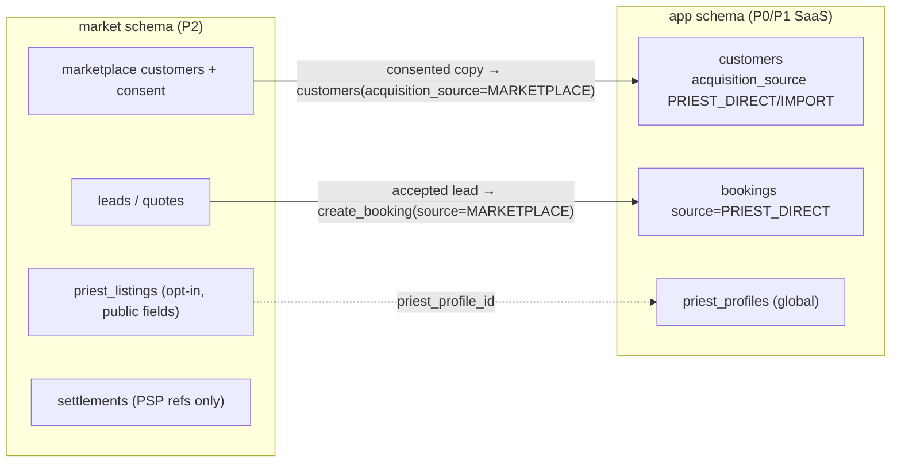

| Rule | How it is guaranteed |
| --- | --- |
| The marketplace never sees a priest's own customers | `market` roles have no grants on `app.customers`; marketplace availability reads only free/busy spans through a function like `app_freebusy` |
| Provenance cannot be rewritten (fee evasion, A6) | `acquisition_source` and `bookings.source` immutable today (triggers, EXECUTED `05`) |
| Customer consent | A family who books through PurohitBook consents to sharing with that priest; the copy in `app.customers` is marked MARKETPLACE |
| Fees | Platform fee only on MARKETPLACE bookings, computed by the PSP split, recorded as references |
| Discovery | Opt-in listing fields only (name, languages, ceremonies, locality, photo); ranking policy published |

What P0 already contains for P2: global priest identity, immutable provenance fields, reservations keyed on the human, offerings per organization. Nothing else is pre-built.

---

# 10 — Infrastructure and Operations

## 1. Environments and placement

| Env | Web | Database | Region | Secrets | Data |
| --- | --- | --- | --- | --- | --- |
| local | `npm run dev` | Postgres 16 (Docker or Supabase CLI) | — | `.env.local` (never committed) | fixtures |
| CI | — | Postgres 16 service container | GitHub-hosted | none | throwaway |
| staging | Vercel preview deployments (Hobby plan until real users; Pro before the pilot) | Supabase project `purohitdesk-staging` (Micro compute) | `bom1` / `ap-south-1` | Vercel "Preview" env | synthetic only |
| production | Vercel production | Supabase project `purohitdesk-prod` (Pro, Micro → Small when needed) | `bom1` / `ap-south-1` | Vercel "Production" env | real |

`vercel.json` pins functions to `bom1` (`vercel.json` at the repo root); the default is `iad1` (US) and would add ~250 ms per database round trip ([Vercel functions limits](https://vercel.com/docs/functions/limitations)). Rejected placements: Render and Railway (no India region), Vercel Hobby (non-commercial) for production. Revision 2.1: Hobby is used for previews until there are real users.

Environment variables (revision 2.1; listed without values in `.env.example`): `NEXT_PUBLIC_SUPABASE_URL`, `NEXT_PUBLIC_SUPABASE_PUBLISHABLE_KEY`, `DATABASE_URL` (server-only; the `app_runtime` connection through Supavisor). Later milestones add their own only after approval.

## 2. CI/CD

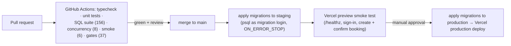

Workflow file: `.github/workflows/ci.yml` implements the check stage only. Revision 2.1: it runs lint, typecheck, unit tests and build on every pull request from M0; SQL suites (throwaway Postgres service container) join as they are built. The staging/production stages are DESIGN; migrations are applied by the founder (T-02 dropped), production in T-21. Rules:

1. Migrations are forward-only, additive first (expand → deploy code → contract later). Never edit an applied migration; add a new one.
2. Migrations are applied **before** the code that needs them; code must tolerate the previous schema for one deploy.
3. Every migration runs in CI against a fresh throwaway database **as a login role without BYPASSRLS or SUPERUSER** (`pd_migrator`), which is how Supabase's `postgres` role behaves ([Supabase roles](https://supabase.com/docs/guides/database/postgres/roles.md)).
4. Revision 2.1: migrations are applied by the founder in the Supabase SQL editor, in filename order. There is no custom runner and no `schema_migrations` table; the Supabase CLI is revisited in M13.
5. Rollback = a new forward migration, or restore (§4) for data loss.

## 3. Monitoring, logging, alerting

| Signal | Tool | Alert |
| --- | --- | --- |
| Uncaught errors, slow requests | Sentry (Next.js SDK), `request_id` in every error envelope | New issue → email/push to founder |
| HTTP logs | Vercel runtime logs (short retention) + log drain to a low-cost store if CERT-In 180-day retention applies (VERIFY) | — |
| Database | Supabase dashboard: CPU, connections, slow queries (`pg_stat_statements`) | CPU > 80% for 10 min |
| Domain health | Daily SQL report (founder's strength): bookings created/confirmed per org, conflicts and buffer acks, voice success rate and spend (`est_cost_paise`), retention counts | Voice failure rate > 20%/day |
| Uptime | External ping on `/api/v1/healthz` every 5 min | 2 consecutive failures |
| Security events | `audit_log` (exports, erasures, org changes), Supabase Auth logs | Any erasure/export outside business hours (informational) |

No PII in logs: log ids and codes, never names, phones, transcripts or message text (lint + review).

## 4. Backups and recovery

| Layer | Mechanism | RPO / RTO | Status |
| --- | --- | --- | --- |
| Supabase daily backups | Included in Pro | 24 h / ~1 h | VERIFY retention on plan |
| Weekly logical dump | `pg_dump --format=custom` of `app` schema + roles DDL, encrypted with `age`, stored outside Supabase (founder's storage) for 30 days | 7 days / 2–4 h | DESIGN |
| PITR | Supabase add-on (~$100/month for 7 days) — **only after paying users** ([Supabase PITR](https://supabase.com/docs/guides/platform/manage-your-usage/point-in-time-recovery)) | minutes | deferred |
| Restore drill | Monthly: restore the latest dump into staging, run `supabase/tests` smoke assertions | — | DESIGN |

## 5. Estimated monthly operating cost

Verified prices (27 Oct 2026): Vercel Pro $20/user/month; Supabase Pro $25 incl. $10 compute credit (covers one Micro), each extra project ≈ +$10 Micro; Sarvam STT ₹0.49/min + GST; Gemini 2.5 Flash $0.30/$2.50 per M tokens; WhatsApp utility ≈ ₹0.145 (BSP card). Exchange rate assumption ₹88/USD. Compute sizes above Micro are estimates (VERIFY on the Supabase pricing page at the time of upgrade).

| Line item | Pilot (≤ 10 priests) | 50 priests | 500 priests |
| --- | --- | --- | --- |
| Vercel Pro (1 seat) | $20 | $20 | $20 + usage ≈ $40 |
| Supabase Pro (prod, Micro) | $25 | $25 | $25 + larger compute ≈ $60–110 (estimate) |
| Supabase staging project | $10 | $10 | $10 |
| PITR | — | — | $100 (once revenue justifies) |
| Domain, email, uptime, Sentry | ≈ $3 | ≈ $3 | ≈ $30 |
| Voice (Sarvam + Gemini) | ≈ ₹270 | ≈ ₹2,250 | ≈ ₹22,500 |
| WhatsApp API (P1 only) | — | ≈ ₹870 | ≈ ₹8,700 |
| **Total (approx.)** | **≈ $58 + ₹270 ≈ ₹5,400** | **≈ $58 + ₹3,100 ≈ ₹8,200** | **≈ $240–290 + ₹31,200 ≈ ₹52,000–57,000** |

Per-priest cost at 500 priests ≈ ₹105–115/month, which sets the floor for P1 pricing.

## 5a. Runbooks (in `supabase/ops/runbook.md`)

- First-time database setup (roles, login password, Cron schedule, disable Data API for `app`).
- Rotating the `app_runtime` password.
- Account deletion and SOLO practice closure.
- Restore from the weekly dump.
- Incident: suspected cross-tenant exposure (freeze writes by revoking EXECUTE from `app_runtime`, preserve logs, notify within CERT-In/DPDP timelines).

---

# 11 — API and Implementation Contracts

Machine-readable contract: `api/openapi.yaml` (OpenAPI 3.1, 40 operations, every response typed). It is checked in CI against the database: 32 real command outputs covering 29 operations are validated against their response schemas, and every function the API role may execute must be mapped to an endpoint (`tools/check_consistency.py`, EXECUTED).

## 1. Conventions

| Topic | Rule |
| --- | --- |
| Base path | `/api/v1`; JSON; UTF-8; `snake_case` fields matching SQL columns |
| Auth | `Authorization: Bearer <Supabase access token>` on everything except `/healthz` |
| Tenant | `X-Tenant-ID: <organization uuid>` on tenant endpoints; non-member → 404 |
| Writes | `Idempotency-Key` (8–128 chars) required on every command that takes one; request hash = SHA-256(`METHOD` + path + canonical JSON body) |
| Concurrency | `ETag: "<version>"` on versioned resources; `If-Match` required on updates; stale → 409 `VERSION_CONFLICT` |
| Money | integer paise (`*_paise`); UI formats ₹ with Indian grouping |
| Time | RFC 3339 instants (UTC) + `timezone` + `local_date` |
| Lists | keyset pagination: `limit` (≤ 100), opaque `cursor` = base64 of the last `(sort key, id)`; response `{data, next_cursor}` |
| Validation | Zod schemas derived from the OpenAPI component schemas; unknown fields rejected |
| Errors | `{"error": {"code", "reason?", "message", "request_id", "details?"}}` |

## 2. Endpoints and per-endpoint authorization

Generated from `api/openapi.yaml` (`python3 tools/render_tables.py endpoints`). "SELECT under RLS" endpoints run a read query as `app_runtime` after the membership probe; the reference queries for sessions, events and payments are in `supabase/tests/contract_samples.sql`.

| Method | Path | Permission | Database function | Idem-Key | If-Match |
| --- | --- | --- | --- | :---: | :---: |
| GET | `/healthz` | none (returns `200 {"status":"ok","commit":"<git sha>"}`) | `—` |  |  |
| GET | `/session` | authenticated | `app.ensure_current_user` |  |  |
| PATCH | `/me` | authenticated | `app.update_my_profile` |  |  |
| POST | `/onboarding/practice` | authenticated (max 3 organizations per user) | `app.bootstrap_practice` | ✓ |  |
| GET | `/organization` | ORG_READ | `SELECT under RLS` |  |  |
| PATCH | `/organization` | ORG_SETTINGS | `app.update_organization` | ✓ | ✓ |
| PATCH | `/priests/{organizationPriestId}` | ORG_SETTINGS, or the priest himself | `app.update_priest_settings` | ✓ |  |
| GET | `/ceremony-types` | authenticated | `—` |  |  |
| GET | `/offerings` | ORG_READ | `SELECT under RLS` |  |  |
| POST | `/offerings` | CATALOG_WRITE | `app.save_offering` | ✓ |  |
| PATCH | `/offerings/{offeringId}` | CATALOG_WRITE | `app.save_offering` | ✓ | ✓ |
| GET | `/samagri-templates` | ORG_READ | `SELECT under RLS` |  |  |
| POST | `/samagri-templates` | CATALOG_WRITE | `app.save_samagri_template` | ✓ |  |
| PUT | `/samagri-templates/{templateId}` | CATALOG_WRITE | `app.save_samagri_template` | ✓ | ✓ |
| GET | `/customers` | CUSTOMER_READ | `SELECT under RLS` |  |  |
| POST | `/customers` | CUSTOMER_WRITE | `app.create_customer` | ✓ |  |
| GET | `/customers/{customerId}` | CUSTOMER_READ | `SELECT under RLS` |  |  |
| PATCH | `/customers/{customerId}` | CUSTOMER_WRITE | `app.update_customer` | ✓ | ✓ |
| POST | `/customers/{customerId}/erase` | CUSTOMER_ERASE | `app.erase_customer` | ✓ | ✓ |
| GET | `/availability` | ORG_READ | `app.priest_busy` |  |  |
| POST | `/blocks` | BLOCK_MANAGE, or BLOCK_MANAGE_OWN for own calendar | `app.create_block` | ✓ |  |
| DELETE | `/blocks/{blockId}` | BLOCK_MANAGE, or BLOCK_MANAGE_OWN for own calendar | `app.release_block` | ✓ |  |
| GET | `/bookings` | BOOKING_READ | `SELECT under RLS` |  |  |
| POST | `/bookings` | BOOKING_CREATE (+ BOOKING_CONFIRM[_OWN] when confirm=true) | `app.create_booking` | ✓ |  |
| GET | `/bookings/{bookingId}` | BOOKING_READ | `app.get_booking` |  |  |
| PATCH | `/bookings/{bookingId}` | BOOKING_EDIT; changing priest_ids as PRIEST (BOOKING_CONFIRM_OWN only) requires being LEAD before and after | `app.update_booking` | ✓ | ✓ |
| POST | `/bookings/{bookingId}/confirm` | BOOKING_CONFIRM, or BOOKING_CONFIRM_OWN when the actor is the LEAD priest before and after any priest_ids change | `app.confirm_booking` | ✓ | ✓ |
| POST | `/bookings/{bookingId}/reschedule` | BOOKING_CONFIRM, or BOOKING_CONFIRM_OWN when the actor is the LEAD priest before and after any priest_ids change | `app.reschedule_booking` | ✓ | ✓ |
| POST | `/bookings/{bookingId}/cancel` | BOOKING_CANCEL, or BOOKING_CANCEL_OWN when the actor is the LEAD priest | `app.cancel_booking` | ✓ | ✓ |
| POST | `/bookings/{bookingId}/complete` | BOOKING_COMPLETE, or BOOKING_COMPLETE_OWN when the actor is the LEAD priest | `app.complete_booking` | ✓ | ✓ |
| GET | `/bookings/{bookingId}/events` | BOOKING_READ | `SELECT under RLS` |  |  |
| PUT | `/bookings/{bookingId}/samagri` | BOOKING_EDIT | `app.attach_samagri` | ✓ |  |
| POST | `/bookings/{bookingId}/share` | SHARE_MESSAGE | `app.prepare_share` |  |  |
| GET | `/bookings/{bookingId}/payments` | BOOKING_READ | `SELECT under RLS` |  |  |
| POST | `/bookings/{bookingId}/payments` | PAYMENT_RECORD | `app.record_payment` | ✓ |  |
| POST | `/payments/{entryId}/reverse` | PAYMENT_REVERSE | `app.reverse_payment` | ✓ |  |
| POST | `/voice/extractions` | VOICE_USE to start (quota per organization); later steps recorder only | `app.begin_voice_extraction, app.finish_voice_extraction` | ✓ |  |
| GET | `/voice/extractions/{extractionId}` | recorder only (the member who started the extraction; enforced by RLS and the function) | `SELECT under RLS` |  |  |
| POST | `/voice/extractions/{extractionId}/discard` | recorder only (the member who started the extraction; enforced by RLS and the function) | `app.discard_voice_extraction` |  |  |
| GET | `/exports/{kind}.csv` | EXPORT_DATA | `app.begin_export` |  |  |

## 3. Error mapping (implemented in `src/domain/errors.ts`, unit-tested)

| SQLSTATE (raised by) | HTTP | `code` | Typical `reason` / `details` |
| --- | --- | --- | --- |
| PD401 (`_require_ctx`, `ensure_current_user`) | 401 | UNAUTHENTICATED | CONTEXT_MISSING |
| PD403 (`assert_permission`, `_OWN` checks) | 403 | FORBIDDEN | `details.permission` |
| PD404 (lookups under RLS) / 23503 (composite FK to another tenant) | 404 | NOT_FOUND | `details.resource` |
| PD409 (`_lock_booking` etc.) | 409 | VERSION_CONFLICT | `details.current_version` |
| PD410 (state guard, commands) | 409 | INVALID_TRANSITION | `details.from`, `details.to` |
| PD412 (`_idem_begin`) | 409 | IDEMPOTENCY_REUSE | `details.reason = original_response_erased` when applicable |
| 23P01 (`_reserve_booking`, exclusion constraint) | 409 | BOOKING_CONFLICT | `details.conflicts[]` (times; ids only for own org) |
| PD449 (`_reserve_booking`) | 409 | BUFFER_CONFLICT | `details.conflicts[]`; resend with `ack_buffer_overlap=true` |
| 23505 | 409 | DUPLICATE | (PostgreSQL detail dropped: may echo values) |
| PD422, 23514, 22P02, 22007, 22008, 22023 | 422 | VALIDATION_FAILED | IMMUTABLE_FIELD, IDEMPOTENCY_KEY_REQUIRED; `details.field` |
| PD429 | 429 | QUOTA_EXCEEDED | VOICE_BUSY; `details.limit` |
| PD405 (append-only), PD500 (invariant), 42501 (privilege) | 500 | INTERNAL | never shown to users: these mean a bug |
| vendor timeout/5xx | 503 | VENDOR_UNAVAILABLE | voice only; manual entry remains |

## 4. Route handler template

```ts
// src/app/api/v1/bookings/[id]/confirm/route.ts  (Sprint 2 pattern; every command endpoint looks like this)
export async function POST(req: Request, { params }: { params: Promise<{ id: string }> }) {  // Next 15+: params is async
  const { id } = await params;
  const ctx = await requireContext(req);                 // verify JWT, read X-Tenant-ID, Idempotency-Key
  const version = parseIfMatch(req);                     // '"3"' -> 3, else 428/422
  const body = ConfirmRequest.parse(await req.json());   // Zod, mirrors components.schemas.ConfirmRequest
  const hash = requestHash('POST', `/bookings/${id}/confirm`, body);
  const result = await withTenantTx(sql, ctx, (tx) => command<BookingCommandResult>(tx,
    tx`SELECT app.confirm_booking(${id}::uuid, ${version}::int, ${body.priest_ids ?? null}::uuid[],
                                  ${body.ack_buffer_overlap ?? false}::boolean, ${ctx.idempotencyKey}, ${hash}) AS result`));
  return json(result, 200, { ETag: `"${result.version}"` });
}                                                         // DomainError -> error envelope in one shared wrapper
```

## 5. Events and background tasks

| Kind | P0 | P1 |
| --- | --- | --- |
| Domain history | `booking_events` written in the same transaction as each command (12 event types, `docs/05` §11) | unchanged |
| Organization audit | `audit_log` (ORG_UPDATED, BLOCK_CREATED, CUSTOMER_ERASED, EXPORT) | + MEMBER_INVITED, MEMBER_REVOKED, PRIEST_LINKED |
| Integration events | none (no consumer) | `app.outbox` rows written by commands: `booking.confirmed`, `booking.rescheduled`, `booking.cancelled`, `reminder.due` (payload ids only, `dedupe_key`) |
| Scheduled jobs | `app.run_retention()` hourly via Supabase Cron | `dispatch_due_messages()` every minute; subscription reconciliation daily |
| Webhooks | none | WhatsApp (GET verify + HMAC POST), billing provider (signature + event id dedupe) |

---

# 12 — Defect Resolution (Phase 3)

"EXECUTED" means the named test was reported to have run and passed on PostgreSQL 16 in the original pack (revision 2.1: not supplied to this repository; to be rebuilt and re-proven) (`supabase/tests/run.sh`, `supabase/tests/concurrency.sh`, `tools/check_consistency.py`, `node --test`). "DESIGN" means the control is specified but has not run. Nothing here has run on a real Supabase project, Vercel, or a real vendor (see `docs/14` §3).

Test references use `file › assertion name` exactly as printed by the runner.

## 1. Required areas

| Area | Earlier finding | Engineering control | Demonstrating test | Status |
| --- | --- | --- | --- | --- |
| RLS bootstrap | B1: bootstrap needed BYPASSRLS | `app.bootstrap_practice` owned by NOLOGIN `app_bootstrap` with policies that only allow rows owned by the verified actor; refuses tenant context; ≤ 3 orgs/user; idempotent | `01 › bootstrap creates practice + the chosen offerings (at least 1) as app_runtime (no BYPASSRLS anywhere)`, `› same Idempotency-Key + same body replays the same org`, `› an actor that is not a Supabase auth user cannot bootstrap`, `› organization quota per user`; gate `db: no application role has BYPASSRLS or SUPERUSER` | EXECUTED |
| Privileged worker access | B8: worker could not see outbox; no role | P0 has no worker (ADR-008). Retention runs as `app_maintenance` via its own function and policies. P1 worker pattern: NOLOGIN owner + role-scoped policies (`docs/07`) | `02 › runtime cannot run retention`; `08 › transcripts older than 7 days purged`, `› expired idempotency keys deleted` | EXECUTED (retention) / DESIGN (P1 worker) |
| Tenant membership and role verification | A7: RLS on 3 tables, tenant only; A: tenant in JWT | FORCE RLS everywhere with ACTIVE-membership predicate; permission matrix in `app.role_permissions` checked in every command; API membership probe | `02 › forged tenant header: zero rows`, `› forged tenant header: commands answer 404, not 403`, `› missing context: commands refuse`, `› READ_ONLY cannot write`, `› STAFF cannot confirm`, `› revoked member sees nothing immediately`; gates `db: RLS enabled…`, `db: FORCE RLS…` | EXECUTED (DB); API probe DESIGN (type-checked) |
| Unauthorized cross-organization priest linking | B2 | API role has no INSERT on `organization_priests`; only BOOTSTRAP links to one's own profile; P1 invitation accepted by the priest | `02 › org B cannot link a priest without his consent`, `› a priest link of another organization cannot be assigned` | EXECUTED (P1 acceptance DESIGN) |
| Tenant-aware foreign keys | A2 | `UNIQUE (id, org_id)` + composite FKs on every tenant reference | `02 › composite FK blocks a cross-tenant customer reference`; `05 › even app_domain cannot write into another tenant` | EXECUTED |
| Global priest reservation conflicts | A3; A1 (constraint never created) | One `priest_profiles` row per human; exclusion on `(priest_profile_id, span)`; stored range columns (no STABLE expressions) | `04 › cross-organization double booking of one priest is impossible`; `concurrency.sh` 3 × two-session race; `01 › one human keeps ONE global priest profile across his practices` | EXECUTED |
| Multi-priest scheduling | B9 (no assignment path), B3 | `priest_ids` on create/update/confirm/reschedule; one LEAD; all-or-nothing reservation under sorted advisory locks; PRIEST cannot reassign others' bookings (R1) | `04 › one busy priest fails the whole team`, `› no partial reservation for the free priest`, `› one LEAD + one ASSISTANT`, `› every assigned priest is reserved` | EXECUTED |
| Travel buffers and overrides | A4 (override removes row from constraint), B4 (no storage) | Buffers stored; buffer-only overlap → BUFFER_CONFLICT unless acknowledged; ceremony overlap never overridable | `04 › buffer-only overlap requires explicit acknowledgement`, `› acknowledged overlap is recorded`, `› ceremony overlap is a hard conflict even when acknowledged`; `concurrency.sh` buffer-only race | EXECUTED |
| Overnight and uncertain availability | (both under-specified) | Date-only drafts; tentative windows; spans across midnight; ≤ 7 days; IANA zone + `local_date` CHECK | `03 › date-only draft allowed`, `› cannot confirm without a time`, `› tentative window blocks the whole window`, `› overnight booking conflicts across midnight`, `› bookings longer than 7 days are rejected`, `› local_date is the IST start date` | EXECUTED |
| Booking state consistency | A5 (RESCHEDULED escapes constraint), B3 | Four states; guard trigger; deferred invariant triggers tie status ↔ assignments ↔ reservations | `05 › CONFIRMED booking without lead/reservation is rejected by the database`, `› moving a confirmed booking without moving its reservation is rejected`, `› cancelling without releasing the reservation is rejected`, `› COMPLETED -> DRAFT is not a valid transition`; `03 › terminal booking is immutable` | EXECUTED |
| Append-only payment records | A: denormalised totals; B: OK but untested | Trigger-enforced append-only entries; reversals; derived balance | `06 › reversal negates the original entry exactly`, `› an entry can be reversed only once`, `› ledger entries are append-only (UPDATE)`, `› … (DELETE)`, `› network retry with the same key does not double-record` | EXECUTED |
| Deletion vs referential integrity | B7 (auth delete failed; audit purge blocked) | `auth_user_id … ON DELETE SET NULL`; erasure = pseudonymise + scrub, never delete referenced rows; retention purge by dedicated role | `08 › org owner's auth account deleted; app user row detached, organization history intact`, `› deleted identity cannot sign back in`, `› erasure scrubs every booking of the person…`, `› audit entries older than 12 months deleted (only those)` | EXECUTED |
| API authorization | B9 (bearer on webhook, untyped responses, missing params) | Every endpoint has `x-permission`; DB enforces; every runtime-executable function mapped to an endpoint; typed responses validated against real output | gates `contract: …` (4), `rbac: …` (2), `samples: 32 real command outputs (29 operations) match…` | EXECUTED (contract vs DB); route handlers DESIGN |
| AI-generated data safety | A: LLM resolves dates and sees phones; A12 model expiry | Phrases-only schema; deterministic resolvers; grounding; human confirm; recorder-only single apply; model ids in config | `07 › booking created only by the human confirm call`, `› a draft can be applied only once`, `› another tenant cannot apply the draft`, `› implausible device time is replaced by server time`; `domain.test.ts` (agle Sunday, amounts, review draft) | EXECUTED (DB + resolvers); real-audio accuracy VERIFY |
| Database migration consistency | A1 (DDL fails), A10 (half the tables missing), B13 | All P0 tables in 7 migrations applied in CI from scratch as a non-superuser without BYPASSRLS; enums identical across SQL/TS/OpenAPI | `run.sh` (applies all, 156 assertions); gates `enum: …` (12) | EXECUTED (local PG 16); on Supabase VERIFY (T-04) |

## 2. Every earlier defect

| ID | Resolution | Status |
| --- | --- | --- |
| A1 | Busy spans are stored columns on `calendar_reservations`; no expressions in constraints | EXECUTED |
| A2 | Composite tenant FKs | EXECUTED |
| A3 | Global priest identity | EXECUTED |
| A4 | No override flag; buffer acknowledgement only | EXECUTED |
| A5 | No RESCHEDULED state | EXECUTED (CHECK + guard) |
| A6 | Provenance immutable (`customers.acquisition_source`, `bookings.source`/`created_via`, `org_id`) | EXECUTED `05 › customer acquisition_source is immutable`, `› booking channel is immutable`, `› a booking cannot move to another organization` |
| A7 | RLS on all tables with membership | EXECUTED |
| A8 | Customer phone optional and not unique; Google sign-in needs no phone | EXECUTED (schema; `02` creates customers without phone) |
| A9 | `version` + If-Match | EXECUTED `03 › stale expected version is rejected` |
| A10 | Complete P0 DDL | EXECUTED |
| A11 | Costs re-derived from verified prices (`docs/10`) | Verified sources |
| A12 | Models in config; Gemini 2.5 Flash (no announced shutdown) | Verified sources / DESIGN |
| A13 | WhatsApp re-costed after 1 Oct 2026 change | Verified sources (BSP rate secondary) |
| B1–B4 | See §1 | EXECUTED |
| B5 | Tenant switcher: `organizations_member_read` uses `is_active_member_of(id)` without a selected tenant | EXECUTED `01 › tenant switcher lists only own organizations`; `02 › revoked member no longer lists the org` |
| B6 | Writes are commands (org update, priest settings, profile); member management is P1 | EXECUTED (samples `updateOrganization`, `updatePriestSettings`, `updateMyProfile`) / P1 DESIGN |
| B7 | See §1 | EXECUTED |
| B8 | See §1 | DESIGN for P1 |
| B9 | OpenAPI rewritten: assignment fields, availability params, If-Match only on versioned resources, export endpoint, typed responses; webhooks are P1 with HMAC | EXECUTED (gates) |
| B10 | `idempotency_keys.org_id` nullable, `command` column, key claimed in-transaction | EXECUTED `01`, `09`, `concurrency.sh` |
| B11 | INQUIRY not in P0; P1 adds INQUIRY → DRAFT/CANCELLED | DESIGN |
| B12 | Facts re-verified (`docs/00` §4) | Verified sources |
| B13 | Missing artifacts replaced by this pack | — |
| Risk: idempotency race | Key claimed inside the command transaction | EXECUTED `concurrency.sh` (same key concurrently → one booking, one replay) |
| Risk: pooler context leak | Transaction-local settings; fail-closed | EXECUTED (fail-closed `02`); Supavisor behaviour VERIFY (T-04) |
| Risk: client-supplied audio key (B) | No audio storage; audio uploaded in the request | DESIGN (removed attack surface) |
| Risk: 409 leaks other bookings (A) | Conflict details carry times only; ids only for own org | EXECUTED `04 › org B sees only busy spans of org A, never its booking ids` |
| Risk: public token pages (A) | P1 hashed, expiring, single-booking tokens through `app_public` | DESIGN |

## 3. Defects found while building v2 (all fixed and re-tested)

| # | Defect in the first draft | Fix | Proof |
| --- | --- | --- | --- |
| 1 | `ALTER DEFAULT PRIVILEGES IN SCHEMA … REVOKE EXECUTE FROM PUBLIC` does not remove PUBLIC's global default, so the API role could run `run_retention()` | Explicit `REVOKE EXECUTE ON ALL FUNCTIONS IN SCHEMA app FROM PUBLIC` in every migration | `02 › runtime cannot run retention`; gate `db: no app function is executable by PUBLIC` |
| 2 | Handing function ownership to NOLOGIN roles failed (new owner needs CREATE on the schema) | Temporary `GRANT CREATE` during hand-over, revoked after | Migrations apply as `pd_migrator` |
| 3 | STAFF could not save a draft in a collective (no default priest) | Drafts may have no assignment; confirm requires a LEAD | `02 › STAFF can create a draft`; `03 › cannot confirm without a time` |
| 4 | Unauthorized callers got validation errors (leaks rules) before 403 | `_assert_any` permission pre-check first | `02 › STAFF cannot confirm`; `04 › PRIEST cannot confirm another priest's booking` |
| 5 | Invalid time zone surfaced as raw 22023 | `_check_tz` → VALIDATION_FAILED | `03 › unknown IANA timezone rejected` |
| 6 | Applying another tenant's voice draft surfaced an FK error after the insert | Validate (READY, own, FOR UPDATE) before inserting | `07 › another tenant cannot apply the draft` |
| 7 | Retention UPDATE violated its own RLS policy (new row must stay visible) | Policy predicate the purge cannot falsify | `08 › transcripts older than 7 days purged` |
| 8 | The cross-tenant `get_booking` assertion passed trivially (no real id) | Moved to `04` with a real booking id | `04 › booking read model returns nothing across tenants` |
| 9 | API role could EXECUTE `assert_permission` and `current_priest_profile_id` without needing them | Revoked; new gate requires every runtime-executable function to be an endpoint or used by its policies | gate `contract: every function app_runtime may EXECUTE is an endpoint or used by its RLS policies` |
| 10 | Reschedule stored a free-text reason in append-only history (unerasable personal data) | `reason_code` enum; unknown fields rejected | `08 › free-text reasons cannot enter the append-only history (reason_code only)`; gate `enum: reschedule reason codes…` |
| 11 | Erasure left `cancel_reason` free text | Erasure clears it; guard allows only clearing on terminal bookings | `08 › free-text cancellation reason erased` |
| 12 | Stored idempotent responses kept an erased person's details for up to 24 h | Erasure scrubs them (scoped policy); replay of a scrubbed response is refused | `08 › stored idempotent responses no longer hold the erased details`, `› replaying a request whose stored response was erased is refused` |
| 13 | Long WhatsApp messages were cut mid-content | Trim samagri items first, keep essentials, cap 1,800 chars | `domain.test.ts › long samagri lists are trimmed before essentials` |

## 4. Defects found by an independent review of this pack (fixed and re-tested)

A separate reviewer compared every document with the SQL, OpenAPI, TypeScript and tests (17 findings: 3 high, 9 medium, 5 low). All cited test names and counts were confirmed. The code-level findings were fixed and tested; the documentation findings were corrected.

| # | Finding | Fix | Proof |
| --- | --- | --- | --- |
| R1 (high) | A PRIEST could gain `_OWN` rights over another priest's booking by reassigning it (`confirm_booking` applied `priest_ids` before checking; `update_booking` let any BOOKING_EDIT holder reassign) | `_OWN` checked before **and** after reassignment; `_assert_assignment_change` lets a PRIEST change assignments only on bookings he leads; STAFF may still assign | `04 › PRIEST cannot take over another priest's booking by reassigning it while confirming`, `› PRIEST cannot reassign another priest's draft to himself`, `› the original LEAD is unchanged`, `› STAFF may assign a priest to a draft (but cannot confirm it)` |
| R2 (high) | Ledger `note`/`external_ref` (and the reversal reason) are free text in an append-only table and survived erasure | `tg_payment_guard`: only change allowed is setting them to NULL; `erase_customer` clears them; column-level UPDATE grant | `06 › ledger notes cannot be rewritten`, `› ledger free text can be erased (amounts untouched)`; `08 › ledger free text erased, amount kept` |
| R3 (high) | `CLAUDE.md` recipe omitted the temporary `GRANT CREATE ON SCHEMA` needed to hand over function ownership | Recipe corrected | Same pattern as the tested DO block in `…000700` |
| R4 | `app_freebusy` could read every column (notes, creators) of other organizations' reservations | Column-level SELECT on busy-time and key columns only | Gates + `04` conflict tests still pass with the narrower grant |
| R5 | Free-text note could be put on a BOOKING reservation | `CHECK (note IS NULL OR kind = 'BLOCK')` | `05 › free-text notes are allowed only on BLOCK reservations` |
| R6 | Time-zone abbreviations (`IST`) and POSIX strings were accepted | `app.is_valid_timezone`: IANA `Area/Location` or `UTC`, and recognised by PostgreSQL | `03 › time-zone abbreviations are rejected (IANA names only)` |
| R7 | "Confirming requires a LEAD" and the one-active-reservation index had no test | Tests added | `04 › confirming requires a LEAD priest`; `05 › one ACTIVE reservation per (booking, priest)` |
| R8–R17 | Documentation: overstated free/busy and retention policies, blocks vs `_reserve_booking`, tenant FK wording, sprint numbering of adapters, function time limit, CI described as deploying, idempotency exemptions, API-role visibility, VOICE_USE scope, counts | Corrected in `docs/03`, `04`, `05`, `08`, `10`, `11`, `15`, `CLAUDE.md`, OpenAPI `x-permission` texts | Re-checked against the artifacts |

Contract issue found by the gates (fixed, design-level): list endpoints would have returned `200 []` to non-members while commands return 404. `withTenantTx` now probes membership once per request and returns 404 (type-checked; runs against a database in T-05).

---

# 13 — Backlog, Roadmap and First Sprint

Revision 2.1: nothing from the original pack was delivered to this repository. The P0 schema and command layer, SQL tests, concurrency harness, OpenAPI contract, `src/domain` and `src/db` are designed in this document and built milestone by milestone (`docs/plan.md`), with every proposal approved by the founder first. The tickets below remain the reference for scope and acceptance criteria; the build order is `docs/plan.md`.

## 1. Global Definition of Done (every ticket)

1. Acceptance criteria demonstrated by automated tests (SQL test for any database change; unit/integration test for TS).
2. `npm run lint`, `npm run typecheck`, `npm test` and `npm run build` green, plus the SQL suites (throwaway Postgres) once they exist; the real output is shown.
3. OpenAPI (`api/openapi.yaml`, written per milestone) updated when an endpoint changes. The original consistency gates (`tools/check_consistency.py`) were not supplied; any replacement is proposed before it is built.
4. No PII in logs; no new privileges for `app_runtime` beyond EXECUTE on a new command.
5. Hindi and English strings present for any UI text; usable at 360 px.
6. `CLAUDE.md` rules respected; relevant doc in `docs/` updated.

## 2. Roadmap (14 weeks + 2 buffer)

> Revision 2.1: dates and sprints are reference only. Work is planned by milestone, without dates, in `docs/plan.md`.

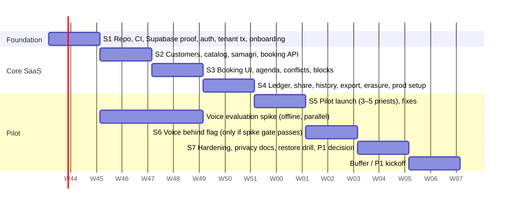

| Sprint | Weeks | Goal | Exit criterion |
| --- | --- | --- | --- |
| S1 | 1–2 | Secure, testable foundation on real infrastructure | T-01…T-07 done; a signed-in user creates a practice on staging |
| S2 | 3–4 | All P0 APIs except voice | Every non-voice operation in OpenAPI implemented and integration-tested |
| S3 | 5–6 | Usable booking flow on a phone | A priest books, confirms, reschedules and cancels on a 2–3 GB Android |
| S4 | 7–8 | Complete P0 without voice; production ready | Production project configured; backup + restore drill passed |
| S5 | 9–10 | Pilot | 3–5 priests use it weekly; bug list triaged |
| S6 | 11–12 | Voice (conditional) | Spike gate passed; voice on for pilot orgs |
| S7 | 13–14 | Hardening and decision | Privacy notice + processor terms; P1 go/no-go memo with usage data |

## 3. Backlog (prioritised)

| ID | Ticket | Depends on | Acceptance criteria |
| --- | --- | --- | --- |
| **T-01** | Project and CI | — | One Next.js app at the repo root (npm; App Router, TS strict, Tailwind) with module folders `src/domain`, `src/db`, `src/adapters`; app boots; `.github/workflows/ci.yml` runs lint, typecheck, unit tests and build on every PR and is green; SQL suites join as they are built. |
| **T-02** | *(Dropped in revision 2.1)* Migration runner | T-01 | No custom runner and no `schema_migrations` table: the founder applies `supabase/migrations/*.sql` in filename order in the Supabase SQL editor. The Supabase CLI is revisited in M13. |
| **T-03** | Staging Supabase project | T-01 | Project in `ap-south-1`; Data API disabled for `app` (or schema not exposed); migrations + seed applied as `postgres`; `app_runtime` given LOGIN + password (`supabase/ops/runbook.md`); Cron job for `app.run_retention()` hourly. |
| **T-04** | Platform proof spike (timebox 2 days) | T-03 | On real Supabase: (a) every migration applies as `postgres` (CREATE ROLE, ownership hand-over, `GRANT SELECT ON auth.users`) — or a documented minimal change; (b) `app_runtime` connects through Supavisor port 6543; (c) `supabase/tests/platform_smoke.sql` passes on staging as `app_runtime` through Supavisor (6 checks); (d) 1,000 interleaved requests from two tenants through a test route on Vercel `bom1`: zero cross-tenant rows, context never survives a transaction; (e) p50/p95 latency from India recorded. Findings written into `docs/14`. |
| **T-05** | Auth and tenant context | T-01, T-04 | `requireContext(req)` verifies the Supabase JWT (JWKS cache), reads `X-Tenant-ID` and `Idempotency-Key`; `withTenantTx` with real `postgres.js` (`prepare:false`); membership probe → 404; shared error wrapper maps `DomainError` to the envelope with `request_id`. Tests: forged/expired token → 401; non-member → 404 on read and write; revoked member denied on next request. ESLint rule: `postgres` importable only in `src/db`. |
| **T-06** | `GET /session`, `PATCH /me` | T-05 | First login creates the app user; memberships with permissions returned; response validates against OpenAPI `Session`. |
| **T-07** | Onboarding | T-06 | `POST /onboarding/practice` with ceremony picker (Hindi/English names from `ceremony_types`); same key replays; slug taken → 409; 4th practice → 429. PWA shell: sign-in, language toggle, tenant switcher. |
| T-08 | Customers API + UI | T-05 | Create/search/edit; duplicate-phone warning from `possible_duplicates`; search by name prefix and phone; If-Match; keyset pagination. |
| T-09 | Export CSV | T-08 | `GET /exports/{kind}.csv` for customers, bookings, payments; audited; cells starting with `= + - @` prefixed with `'`; only own tenant (test with two tenants). |
| T-10 | Erasure | T-08 | `POST /customers/{id}/erase` with confirmation dialog; after erasure the customer and booking free text are gone in UI and API; amounts intact. |
| T-11 | Offerings and samagri templates | T-07 | CRUD per OpenAPI; editing a template never changes an attached booking snapshot (test). |
| T-12 | Booking commands API | T-05, T-11 | All booking endpoints per OpenAPI incl. `priest_ids`, buffers, `ack_buffer_overlap`, `reason_code`; ETag/If-Match; request hash; integration test: 50 runs of two concurrent HTTP confirms for one priest → exactly one 200 and one 409. |
| T-13 | Agenda and availability | T-12 | Day/week list (local dates), "time to fix" drafts, other organizations' busy spans shown as "Busy"; `GET /availability` ≤ 62 days. |
| T-14 | Booking UI | T-12, T-13 | Form with offering → default duration, date-only drafts, tentative toggle, conflict dialog (hard) and buffer dialog (acknowledge); reschedule with reason code; cancel with reason; complete after start. Works at 360 px on a real 2–3 GB Android. |
| T-15 | Voice evaluation spike (offline) | — | ≥ 50 consented recordings, ≥ 5 speakers; Sarvam + one alternative STT; Gemini extraction with `EXTRACTION_JSON_SCHEMA`; per-field exact match and catastrophic error rate reported; go/no-go recorded in `docs/06`. No production code. |
| T-16 | Calendar blocks | T-12 | Create/release blocks; PRIEST only for own calendar. |
| T-17 | Dakshina ledger UI | T-12 | Record receipt/refund, reverse with reason, balance shown; retry-safe. |
| T-18 | Samagri on booking | T-11, T-12 | Attach template; show family vs priest items. |
| T-19 | WhatsApp share | T-18, T-17 | `POST /bookings/{id}/share` + `renderBookingMessage` + `wa.me`/Web Share; Hindi rendering verified on device; event logged only when the priest taps Share. |
| T-20 | Booking history view | T-12 | Events in order with actor names; no free text other than notes. |
| T-21 | Production environment | T-03, T-14 | Prod Supabase + Vercel `bom1`; secrets; uptime ping; Sentry; weekly encrypted dump; restore drill into staging passes the smoke SQL. |
| T-22 | Performance pass | T-14 | Agenda route ≤ 200 KB JS gz; Lighthouse mobile ≥ 80 on a mid-range device profile; fonts subset for Devanagari. |
| T-23 | Pilot onboarding kit | T-21 | Hindi walkthrough, feedback form, support WhatsApp number, privacy notice draft. |
| T-24 | Voice recorder + endpoint | T-15 (go), T-12 | 16 kHz mono WAV encoder in the browser, 30 s cap; `POST /voice/extractions` with Sarvam/Gemini adapters, quota, timeouts (45 s client), failure path to manual form. |
| T-25 | Voice review screen | T-24 | Date chips, AM/PM choice, customer pick/new, amount confirmation; "Confirm & Save" disabled until every flag is resolved; saves via `POST /bookings` (+ payment for advance). |
| T-26 | Voice evaluation in CI (manual trigger) | T-24 | `npm run eval:voice` runs the corpus; results stored as an artifact; never on every PR. |
| T-27 | Account deletion runbook drill | T-21 | Runbook executed on staging; identity detached; history intact. |
| T-28 | Privacy and processor terms | T-23 | Hindi/English privacy notice; priest-as-fiduciary processor terms reviewed by counsel (VERIFY item closed or re-scoped). |

Not in the backlog on purpose (P1+): invitations/collective management, public pages, WhatsApp API, reminders, subscriptions, Punjabi UI, recurring series, families, working-hours rules, UPI links, marketplace.

## 4. Sprint 1 — exact plan (10 working days)

Goal: **a signed-in user can create a practice on staging through the real API, with tenant isolation proven on the real platform and every gate green in CI.**

| Day | Work | Output |
| --- | --- | --- |
| 1 | T-01: create the Next.js app at the repo root (npm, TS strict, Tailwind) with `src/domain`, `src/db`, `src/adapters`; add `.github/workflows/ci.yml` | CI runs lint, typecheck, unit tests and build green |
| 2 | *(T-02 dropped in revision 2.1)* | — |
| 3 | T-03: create staging project (Mumbai), disable Data API exposure of `app`, apply migrations + seed, create `app_runtime` login, schedule Cron | Staging database matching CI |
| 4–5 | T-04 spike: run `supabase/tests/platform_smoke.sql` on staging through the pooler; deploy a temporary `/api/v1/_probe` on Vercel `bom1`; run the 1,000-request two-tenant script; measure latency | Findings in `docs/14` §3; go/no-go for the platform |
| 6–7 | T-05: `requireContext`, JWKS verification, real `withTenantTx`, error wrapper, ESLint boundary rule; integration tests against local Postgres | 401/404/revocation tests green |
| 8 | T-06: `/session`, `/me`; response validated against OpenAPI in tests | Session endpoint on staging |
| 9 | T-07: `/onboarding/practice` + minimal PWA shell (sign-in, Hindi/English toggle, ceremony picker, tenant switcher) | First practice created on staging from a phone |
| 10 | Buffer, review, update `docs/14` with platform results; demo | Sprint report; S2 backlog confirmed |

Sprint 1 risks and fallbacks: if Supabase refuses a role or ownership statement, the migration stops at that exact statement (`ON_ERROR_STOP`); try it from the SQL editor as `postgres`, then raise a Supabase support ticket and decide in T-04 — do **not** work around it with `service_role` or BYPASSRLS. If Supavisor's transaction pooler rejects the custom login role, use the session pooler (port 5432) for pilot volume and revisit.

---

# 14 — Engineering Quality Gates (Phase 5)

## 1. What was executed, and how to reproduce it

> Revision 2.1: this section records results reported by the original pack. Its scripts and tests were not supplied to this repository; the commands below are kept for reference and are rebuilt per milestone (`docs/plan.md`).

Environment: PostgreSQL 16.15 (local cluster, timezone UTC), Node 22.23, TypeScript 7.0.2, Python 3.13 with PyYAML and jsonschema 4.26. Date of run: 27 Oct 2026.

```bash
export PGHOST=… PGPORT=… PGUSER=<superuser>
./supabase/tests/run.sh            # fresh DB; 7 migrations + seed applied as pd_migrator (CREATEROLE, NOBYPASSRLS, not superuser)
./supabase/tests/concurrency.sh    # two real sessions racing
./supabase/tests/smoke_local.sh    # platform smoke as the API login role
python3 tools/check_consistency.py
tsc -p tsconfig.json && node --test src/domain/domain.test.ts
```

| Layer | Result |
| --- | --- |
| SQL suite, 9 files, run as the real roles (`SET ROLE app_runtime` / `app_domain`) | **156 / 156 assertions passed** |
| Concurrency harness (two psql sessions, 1.5 s overlap) | **8 / 8 passed** |
| Platform smoke as `app_runtime` login (same script for staging) | **6 / 6 passed**, re-runnable |
| Consistency gates (OpenAPI, contract, DB security, enums, shapes, RBAC, real outputs, doc citations) | **37 / 37 passed** |
| Domain unit tests | **13 / 13 passed** |
| Typecheck (`strict`, `erasableSyntaxOnly`) | **passed** |

Not executed anywhere: the Next.js application (not yet written), Supabase itself, Supavisor, Vercel, Sarvam, Gemini, WhatsApp, any Android device. Those are §3.

## 2. Final consistency review

| Check | Result | Evidence |
| --- | --- | --- |
| Database entities match the domain model | **Pass** | Gates `shape: Booking identical in app._booking_out, OpenAPI Booking and TS Booking`, `shape: BookingCreate (OpenAPI) identical to TS CreateBookingInput`; 12 `enum:` gates compare every status/kind/role/method/source/locale/reason-code list across SQL CHECKs, TS constants and OpenAPI. |
| API contracts match the selected backend architecture | **Pass** | Every write endpoint names one `x-db-function`; every such function exists and is executable by `app_runtime`; every function `app_runtime` can execute is either exposed or used by its own policies; 32 real outputs from 29 operations validate against their response schemas (`samples:` gate). Route handlers themselves are not written yet (DESIGN). |
| Authorization rules align with database privileges | **Pass** | One permission list in `app.role_permissions` = TS `PERMISSIONS` = OpenAPI `Permission`; every `x-permission` names a real permission; `app_runtime` has no DML; no BYPASSRLS/SUPERUSER app role; no PUBLIC policies or EXECUTE; definer functions pinned. RBAC behaviour tested per role in `02`, `04`, `06`. |
| Booking transitions agree with reservation constraints | **Pass** | Guard trigger (allowed transitions) + deferred invariants (CONFIRMED/COMPLETED ⇔ LEAD + covering reservations; DRAFT/CANCELLED ⇔ none). `05` writes directly as `app_domain` to prove the database rejects inconsistent states even if a command were buggy; `03`/`04` prove each command keeps them consistent. TS `BOOKING_TRANSITIONS` matches the guard (reviewed; not machine-compared). |
| Migration scripts agree with the documented schema | **Pass (by construction)** | `docs/04` is written from the migrations and states that migrations win; tables, roles and policies described there were re-read against the migrations; an independent reviewer then compared every document with the artifacts (17 findings, 3 of them code defects — all resolved and tested, `docs/12` §4); the gate `docs: all … cited test assertions exist in db/tests` now checks test citations mechanically. The RBAC and endpoint tables in docs are generated (`tools/render_tables.py`). |
| Backlog does not require features omitted from the MVP | **Pass** | `docs/13` tickets T-01…T-28 map to P0 scope in `docs/01`; P1 items are listed as excluded. Voice tickets T-24…T-26 are conditional on the T-15 gate. |
| Architecture supports the marketplace without building it | **Pass** | Global priest identity; immutable `acquisition_source`, `source`, `created_via`, `org_id` (tested in `05`); free/busy function returns anonymous spans (pattern for marketplace availability); no marketplace tables, roles or endpoints exist. |
| No important decision left ambiguous | **Pass with named open items** | Every open item is a platform/vendor/legal fact in §3 with an owner ticket, not an undecided design choice. |

## 3. Unverified assumptions (each has a ticket)

| # | Assumption | Why it matters | How/when verified |
| --- | --- | --- | --- |
| U1 | Supabase's `postgres` can create the NOLOGIN roles, `GRANT role TO CURRENT_USER`, hand over function ownership, and `GRANT SELECT ON auth.users` | Migrations stop otherwise | T-04 (day 4–5) |
| U2 | `app_runtime` can log in through Supavisor transaction mode (`<role>.<project-ref>` user format) with `prepare:false` | API connectivity | T-04 |
| U3 | Transaction-local `set_config` behaves identically through Supavisor under load (no context leak) | Tenant isolation at the pooler | T-04 (smoke + 1,000-request two-tenant test) |
| U4 | Latency Chandigarh ↔ Vercel `bom1` ↔ Supabase Mumbai meets the p95 targets | UX on 4G | T-04 |
| U5 | Supabase Cron can run `app.run_retention()` as the migration owner | Retention | T-03 |
| U6 | Hindi/Hinglish STT + extraction accuracy on real pandit speech (amounts, sector numbers, ceremony names) | Voice go/no-go | T-15 |
| U7 | Browser WAV recording works on target Android Chrome versions | Voice | T-24 |
| U8 | PWA performance on 2–3 GB Android with Devanagari fonts | Adoption | T-22 |
| U9 | Phone OTP in India via Supabase SMS provider: DLT registration, deliverability, cost | Sign-in for priests without Google habits | Before enabling OTP (P0 uses Google) |
| U10 | Meta policy on one platform number sending for many independent priests | P1 WhatsApp design and cost | Before P1 |
| U11 | DPDP roles (priest = fiduciary, PurohitDesk = processor), notice/consent wording, breach timelines; CERT-In log retention on chosen plans | Legal compliance by ~13 May 2027 | T-28 with counsel |
| U12 | Supabase compute prices above Micro; Vercel usage at 500 priests | Cost table rows marked "estimate" | At upgrade time |
| U13 | The original requirements prompt matches the reconstructed requirements | Scope | Resolved 28 Oct 2026: confirmed by the founder |

## 4. Test specifications for layers not yet built

These become automated tests in the tickets named; each must run in CI.

| ID | Layer | Specification | Ticket |
| --- | --- | --- | --- |
| API-SEC-1 | Auth | Missing, malformed, expired, wrong-audience, wrong-signature JWT → 401 on every `/api/v1` route except `/healthz` (generated from OpenAPI operation list). | T-05 |
| API-SEC-2 | Tenant | For every operation with `X-Tenant-ID`: a valid user who is not a member gets 404; a READ_ONLY member gets 403 on every write. Generated from OpenAPI + RBAC table. | T-05, T-12 |
| API-SEC-3 | Revocation | Revoke a member between two requests on the same pooled connection; second request → 404. | T-05 |
| API-SEC-4 | Context leak | 1,000 interleaved requests alternating two tenants on a pool of 2 connections: every response contains only its tenant's ids. | T-04 |
| API-SEC-5 | Error leakage | Trigger 23505/23503 through the API: response has no PostgreSQL DETAIL; 23P01 details contain no foreign booking ids. | T-12 |
| API-SEC-6 | CSV injection | Customer named `=HYPERLINK(...)` exports as `'=HYPERLINK(...)`. | T-09 |
| API-SEC-7 | Body limits | Voice upload > 1.2 MB or > 30 s → 413 before any vendor call. | T-24 |
| API-CON-1 | HTTP race | 50 iterations: two concurrent `POST /bookings/{id}/confirm` for overlapping bookings of one priest → exactly one 200 and one 409 `BOOKING_CONFLICT`. | T-12 |
| API-CON-2 | Idempotent retry | Same `Idempotency-Key` sent twice concurrently over HTTP → identical bodies, one with `idempotent_replay`. | T-12 |
| API-CON-3 | Stale edit | Two clients PATCH with the same `If-Match` → one 200, one 409 `VERSION_CONFLICT`. | T-12 |
| API-CTR-1 | Contract | Every route handler's response validated against OpenAPI in integration tests (same validator as the `samples:` gate). | T-06 onward |
| UI-1 | Device | Agenda, booking form, share on a real 2–3 GB Android over throttled 4G; Devanagari renders; `wa.me` opens WhatsApp with the Hindi text intact. | T-14, T-19, T-22 |

## 5. Appendix — executed results (27 Oct 2026)

### 5.1 SQL assertion catalog (156)

**01_bootstrap_identity.sql**

- bootstrap creates practice + the chosen offerings (at least 1) as app_runtime (no BYPASSRLS anywhere)
- same Idempotency-Key + same body replays the same org
- same Idempotency-Key + different body is rejected — `PD412 IDEMPOTENCY_REUSE`
- slug already taken — `23505 duplicate key value violates unique constraint "organizations_slug_key"`
- an actor that is not a Supabase auth user cannot bootstrap — `PD401 CONTEXT_MISSING`
- bootstrap refuses to run inside a tenant context — `PD422 VALIDATION_FAILED`
- tenant switcher lists only own organizations
- no tenant selected -> no tenant data
- first login creates app user
- one human keeps ONE global priest profile across his practices
- organization quota per user — `PD429 QUOTA_EXCEEDED`

**02_isolation_authz.sql**

- tenant B sees only its own customers
- forged tenant header: zero rows
- forged tenant header: zero bookings
- forged tenant header: commands answer 404, not 403 — `PD404 NOT_FOUND`
- missing context: zero rows
- missing context: commands refuse — `PD401 CONTEXT_MISSING`
- runtime cannot INSERT customers directly — `42501 permission denied for table customers`
- runtime cannot UPDATE bookings directly — `42501 permission denied for table bookings`
- runtime cannot DELETE payments — `42501 permission denied for table payment_entries`
- runtime cannot grant itself memberships — `42501 permission denied for table org_members`
- runtime cannot call internal helpers — `42501 permission denied for function _reserve_booking`
- runtime cannot run retention — `42501 permission denied for function run_retention`
- org B cannot link a priest without his consent — `42501 permission denied for table organization_priests`
- a priest link of another organization cannot be assigned — `PD422 VALIDATION_FAILED`
- composite FK blocks a cross-tenant customer reference — `23503 insert or update on table "bookings" violates foreign key constraint "bookings_customer_id_org_id_fkey"`
- READ_ONLY member can read tenant data
- READ_ONLY cannot write — `PD403 FORBIDDEN`
- STAFF can create a draft
- STAFF cannot confirm — `PD403 FORBIDDEN`
- STAFF cannot read the audit log
- revoked member sees nothing immediately
- revoked member no longer lists the org

**03_booking_lifecycle.sql**

- human-readable booking number per org
- new booking is a DRAFT
- end time derived from offering duration
- solo priest auto-assigned as LEAD
- a DRAFT holds no calendar time
- stale expected version is rejected — `PD409 VERSION_CONFLICT`
- confirm DRAFT -> CONFIRMED
- confirm reserves the priest
- cannot confirm twice — `PD410 INVALID_TRANSITION`
- cannot complete before the ceremony starts — `PD422 VALIDATION_FAILED`
- schedule of a CONFIRMED booking changes only via reschedule — `PD422 VALIDATION_FAILED`
- every change bumps the version
- cancelling a CONFIRMED booking needs a reason — `PD422 VALIDATION_FAILED`
- cancel CONFIRMED -> CANCELLED
- cancel releases the slot (history kept)
- terminal booking is immutable — `PD410 INVALID_TRANSITION`
- full audit trail
- date-only draft allowed
- cannot confirm without a time — `PD422 VALIDATION_FAILED`
- tentative window confirmed
- tentative window blocks the whole window — `23P01 BOOKING_CONFLICT`
- local_date is the IST start date
- overnight booking conflicts across midnight — `23P01 BOOKING_CONFLICT`
- bookings longer than 7 days are rejected — `23514 new row for relation "bookings" violates check constraint "bookings_check1"`
- unknown IANA timezone rejected — `PD422 VALIDATION_FAILED`
- time-zone abbreviations are rejected (IANA names only) — `PD422 VALIDATION_FAILED`
- confirm -> complete
- completed ceremony keeps its busy span
- COMPLETED cannot be cancelled — `PD410 INVALID_TRANSITION`

**04_conflicts_buffers_multipriest.sql**

- buffer-only overlap requires explicit acknowledgement — `PD449 BUFFER_CONFLICT`
- acknowledged overlap is recorded
- acknowledgement is in the booking history
- ceremony overlap is a hard conflict even when acknowledged — `23P01 BOOKING_CONFLICT`
- cross-organization double booking of one priest is impossible — `23P01 BOOKING_CONFLICT`
- org B sees only busy spans of org A, never its booking ids
- org B still cannot read org A bookings
- booking read model returns nothing across tenants
- one busy priest fails the whole team — `23P01 BOOKING_CONFLICT`
- no partial reservation for the free priest
- one LEAD + one ASSISTANT
- every assigned priest is reserved
- PRIEST confirms a booking he leads
- PRIEST cannot confirm another priest's booking — `PD403 FORBIDDEN`
- PRIEST cannot block another priest's time — `PD403 FORBIDDEN`
- PRIEST cannot take over another priest's booking by reassigning it while confirming — `PD403 FORBIDDEN`
- PRIEST cannot reassign another priest's draft to himself — `PD403 FORBIDDEN`
- the original LEAD is unchanged
- confirming requires a LEAD priest — `PD422 VALIDATION_FAILED`
- STAFF may assign a priest to a draft (but cannot confirm it)
- reschedule into a conflict is rejected — `23P01 BOOKING_CONFLICT`
- failed reschedule leaves the original reservation
- reschedule releases old and holds new
- blocked time cannot be booked — `23P01 BOOKING_CONFLICT`
- released block frees the time

**05_database_guards.sql**

- CONFIRMED booking without lead/reservation is rejected by the database — `PD500 INVARIANT_VIOLATION`
- moving a confirmed booking without moving its reservation is rejected — `PD500 INVARIANT_VIOLATION`
- cancelling without releasing the reservation is rejected — `PD500 INVARIANT_VIOLATION`
- COMPLETED -> DRAFT is not a valid transition — `PD410 INVALID_TRANSITION`
- one ACTIVE reservation per (booking, priest) — `23505 duplicate key value violates unique constraint "calendar_reservations_one_active_per_assignment"`
- free-text notes are allowed only on BLOCK reservations — `23514 new row for relation "calendar_reservations" violates check constraint "calendar_reservations_check3"`
- even app_domain cannot write into another tenant — `42501 new row violates row-level security policy for table "customers"`
- even app_domain cannot update another tenant's organization
- reservation spans are immutable — `PD405 APPEND_ONLY`
- reservations are never deleted — `PD405 APPEND_ONLY`
- booking history is append-only — `PD405 APPEND_ONLY`
- recent audit entries cannot be deleted — `PD405 APPEND_ONLY`
- customer acquisition_source is immutable — `PD422 IMMUTABLE_FIELD`
- booking channel is immutable — `PD422 IMMUTABLE_FIELD`
- a booking cannot move to another organization — `PD422 IMMUTABLE_FIELD`

**06_ledger.sql**

- advance 1,100 against 5,100 leaves 4,000
- network retry with the same key does not double-record
- exactly one entry stored
- refund is stored negative and raises the balance
- reversal negates the original entry exactly
- an entry can be reversed only once — `PD422 VALIDATION_FAILED`
- a reversal cannot itself be reversed — `PD422 VALIDATION_FAILED`
- zero amount rejected — `PD422 VALIDATION_FAILED`
- reversals only through reverse_payment — `PD422 VALIDATION_FAILED`
- overpayment shows as a credit, not an error
- STAFF cannot reverse ledger entries — `PD403 FORBIDDEN`
- ledger entries are append-only (UPDATE) — `PD405 APPEND_ONLY`
- ledger entries are append-only (DELETE) — `PD405 APPEND_ONLY`
- ledger notes cannot be rewritten — `PD405 APPEND_ONLY`
- ledger free text can be erased (amounts untouched)

**07_voice.sql**

- one in-flight voice job per user — `PD429 VOICE_BUSY`
- extraction ready for review
- another tenant cannot touch the draft — `PD404 NOT_FOUND`
- another tenant cannot apply the draft — `PD422 VALIDATION_FAILED`
- booking created only by the human confirm call
- draft marked APPLIED in the same transaction
- a draft can be applied only once — `PD422 VALIDATION_FAILED`
- implausible device time is replaced by server time
- candidate must be a JSON object — `PD422 VALIDATION_FAILED`
- failed draft discarded
- discard purges content immediately
- colleagues cannot read each other's voice drafts
- daily voice quota enforced — `PD429 QUOTA_EXCEEDED`

**08_erasure_retention.sql**

- free-text reasons cannot enter the append-only history (reason_code only) — `PD422 VALIDATION_FAILED`
- erasure scrubs every booking of the person, including COMPLETED and CANCELLED
- free-text cancellation reason erased
- ledger free text erased, amount kept
- replaying a request whose stored response was erased is refused — `PD412 IDEMPOTENCY_REUSE`
- stored idempotent responses no longer hold the erased details
- customer pseudonymised
- booking free text erased
- linked voice transcript purged
- erasure recorded per booking
- erased customer cannot be edited back — `PD404 NOT_FOUND`
- transcripts older than 7 days purged
- audit entries older than 12 months deleted (only those)
- expired idempotency keys deleted
- recent audit entries kept
- org owner's auth account deleted; app user row detached, organization history intact
- deleted identity cannot sign back in — `PD401 CONTEXT_MISSING`

**09_idempotency.sql**

- replay returns the original booking
- replay is flagged
- only one booking exists
- same key, different body — `PD412 IDEMPOTENCY_REUSE`
- same key, different command — `PD412 IDEMPOTENCY_REUSE`
- keys shorter than 8 chars rejected — `23514 new row for relation "idempotency_keys" violates check constraint "idempotency_keys_key_check"`
- failing command — `PD422 VALIDATION_FAILED`
- key is free again after a failed attempt
- another user may use the same key string

### 5.2 Concurrency harness

    PASS cross-org same priest, overlapping, run 1 | session 2 waited 1.2s | ERROR:  BOOKING_CONFLICT
    PASS cross-org same priest, overlapping, run 2 | session 2 waited 1.2s | ERROR:  BOOKING_CONFLICT
    PASS cross-org same priest, overlapping, run 3 | session 2 waited 1.2s | ERROR:  BOOKING_CONFLICT
    PASS first session rolls back -> second confirms | session 2 waited 1.2s | COMMITTED {"id": "3205e4d2-b04a-4a78-b049-e1991be80925", "notes": null
    PASS buffer-only overlap is evaluated after the first commit (advisory lock) | session 2 waited 1.2s | ERROR:  BUFFER_CONFLICT
    PASS same Idempotency-Key sent twice concurrently -> one booking, one replay | session 2 waited 1.2s | COMMITTED true
    PASS exactly one 'dup race' booking stored
    PASS zero overlapping ACTIVE reservations in the whole database
    == concurrency: 0 failure(s)

### 5.3 Platform smoke (as `app_runtime`)

    ok - transaction-local context is gone after COMMIT
    ok - overlapping confirmation rejected (23P01)
    ok - API role cannot write tables (42501)
    ok - forged tenant header sees zero bookings
    ok - forged tenant command answers PD404
    ok - read model does not cross tenants
    == platform smoke passed

### 5.4 Consistency gates

    PASS  openapi: version 3.1
    PASS  openapi: every $ref resolves
    PASS  openapi: every component schema is valid JSON Schema 2020-12
    PASS  openapi: operationIds present and unique
    PASS  openapi: every tenant endpoint requires X-Tenant-ID
    PASS  openapi: every endpoint documents its permission
    PASS  openapi: every non-trivial endpoint documents error responses
    PASS  contract: every x-db-function exists and app_runtime may EXECUTE it
    PASS  contract: every function app_runtime may EXECUTE is an endpoint or used by its RLS policies
    PASS  contract: commands taking an idempotency key require Idempotency-Key
    PASS  contract: versioned commands require If-Match
    PASS  db: RLS enabled on every app table
    PASS  db: FORCE RLS on every tenant/identity table
    PASS  db: no app function is executable by PUBLIC
    PASS  db: SECURITY DEFINER functions have pinned search_path and NOLOGIN, non-BYPASSRLS owners
    PASS  db: app_runtime has no INSERT/UPDATE/DELETE/TRUNCATE on any app relation
    PASS  db: no application role has BYPASSRLS or SUPERUSER
    PASS  db: no RLS policy applies to PUBLIC
    PASS  enum: bookings.status identical in SQL, TS and OpenAPI
    PASS  enum: org_members.role identical in SQL, TS and OpenAPI
    PASS  enum: payment_entries.kind identical in SQL, TS and OpenAPI
    PASS  enum: payment_entries.method identical in SQL, TS and OpenAPI
    PASS  enum: samagri_template_items.provided_by identical in SQL, TS and OpenAPI
    PASS  enum: voice_extractions.status identical in SQL, TS and OpenAPI
    PASS  enum: booking_events.event identical in SQL and OpenAPI
    PASS  enum: customers.acquisition_source identical in SQL and OpenAPI
    PASS  enum: bookings.created_via identical in SQL and OpenAPI
    PASS  enum: calendar_reservations.kind identical in SQL and OpenAPI
    PASS  enum: app_users.preferred_locale identical in SQL and OpenAPI
    PASS  enum: reschedule reason codes identical in SQL command, TS and OpenAPI
    PASS  shape: Booking identical in app._booking_out, OpenAPI Booking and TS Booking
    PASS  shape: BookingCreate (OpenAPI) identical to TS CreateBookingInput
    PASS  rbac: permission names identical in app.role_permissions, TS PERMISSIONS and OpenAPI
    PASS  rbac: every x-permission names a real permission
    PASS  samples: 32 real command outputs (29 operations) match their OpenAPI response schema
    PASS  samples: an idempotent replay returns the stored body with idempotent_replay=true
    PASS  docs: all 95 cited test assertions exist in db/tests
    == 37/37 consistency gates passed

### 5.5 Domain unit tests

(Empty in the source. Revision 2.1: domain tests are proposed per milestone in `docs/plan.md`.)

---

# Appendix — CLAUDE.md (engineering rules for coding agents)

Revision 2.1: the engineering rules that used to be reproduced here now live in [`CLAUDE.md`](../CLAUDE.md) at the repository root, merged with the founder's rules. `CLAUDE.md` is the single rule file and wins over this document on conflict.
